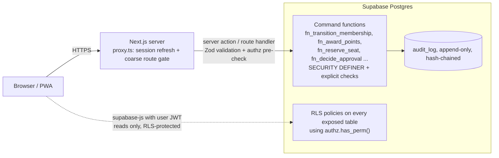

# Document 2: User Role and Permission Matrix

> Access control is enforced in **three server-side layers**: (1) the Next.js server (route guards and server actions), (2) **Postgres Row-Level Security** on every exposed table, and (3) **permission-checked command functions** for every state change that matters. The UI only *reflects* permissions and never *grants* them. A user who edits the browser, calls the API directly, or replays requests gets exactly the same answer as the UI would give them.

## 1. Model: RBAC with scopes, mandates and separation of duties

```
person ──< role_assignments >── role ──< role_permissions >── permission
              │  scope_type: global | unit | event | self
              │  scope_id:   org_unit.id | event.id | null
              │  valid_from / valid_until / revoked_at
              └─ granted_by, confirmed_by (for privileged roles)

person ──< approval_mandates (Teacher Approvers & finance roles)
              categories[], max_amount_bdt, valid_until, granted_by
```

- **Roles** bundle permissions. **Scopes** narrow them (e.g. *Team Lead of Marketing Wing* = role `team_lead`, scope `unit:marketing`).
- **Mandates** are explicit, individually granted decision rights with limits. A teacher gets nothing by being a teacher. They get decision power only through a mandate.
- **Permission resolution happens in the database** (`authz.has_perm(perm, scope_type, scope_id)`), reading live `role_assignments`. JWT custom claims carry only a *hint* (role list for UI routing). They are never used to authorise writes, so a revoked role takes effect on the next request instead of waiting for token expiry.
- **Separation of duties (SoD)** rules are enforced inside the command functions (§6).

## 2. Role catalogue

| Role key | Name | How assigned | Scope | MFA | Notes |
|---|---|---|---|---|---|
| `super_admin` | Super Admin | **Seeded only** from the confirmed allowlist (2 identities). Further promotion needs an existing SA + the other SA's confirmation | global | **Required** | Cannot be self-granted. Removing the last active SA is blocked |
| `teacher_approver` | Teacher Approver | SA grants the role **and** at least one mandate | global (mandate-limited) | **Required** | Decision rights only within mandate categories and ceilings |
| `teacher` | Teacher / Advisor | SA invites | self | Optional | Read-only portal |
| `hr` | HR Officer | SA assigns | global or unit | Recommended | Tasks, reviews, point *recommendations* |
| `team_lead` | Department / Team / Wing Lead | SA or HR assigns | unit | Recommended | Own unit only |
| `finance_officer` | Finance Officer / Treasurer *(optional)* | SA assigns + mandate | global | **Required** | Maker for disbursements, verifier for incoming payments |
| `event_manager` | Event Manager *(optional)* | SA assigns | event or global | Recommended | Configure events, registrations |
| `checkin_staff` | Check-in Volunteer *(optional)* | Event Manager assigns | event, time-boxed | — | Scan tickets during the event window only |
| `content_editor` | Content Editor *(optional)* | SA assigns | global | Recommended | CMS, blog, gallery, media |
| `judge` | Competition Judge *(optional)* | Event Manager assigns | event/round | — | Sees only assigned submissions |
| `member` | Finalised / Active Member | Automatic on status `finalized`/`active` | self | Optional | Own records, tasks, events |
| `applicant` | Applicant / Provisional Member | Automatic on provisioning | self | — | Own application only |
| `alumni` | Alumni *(read-only member)* | Automatic on status `alumni` | self | — | Certificates, CV, history |
| `public` | Public Visitor (anonymous) | — | — | — | Published content, registration, verification |

**Role-assignment rules.** A person can hold several roles. Effective permissions are the union, still constrained by scope and SoD. Roles derived from membership status (`member`, `applicant`, `alumni`) are **computed**, not assigned, so a suspended member loses `member` permissions immediately.

## 3. Permission catalogue (keys used in RLS and functions)

| Domain | Permission keys |
|---|---|
| Identity | `identity.invite`, `identity.suspend`, `identity.read_restricted`, `rbac.manage`, `rbac.manage_privileged`, `approver.manage` |
| People | `people.read`, `people.read_restricted` (phone, personal email), `people.verify` (apply corrections), `people.manage` |
| Membership | `membership.cycle.manage`, `membership.review`, `membership.decide`, `membership.finalize`, `membership.suspend`, `membership.bulk`, `membership.export`, `membership.config` |
| Org | `org.manage`, `org.assign` |
| Tasks | `task.type.manage`, `task.create`, `task.assign`, `task.review`, `task.appeal.decide` |
| Points | `points.recommend`, `points.award`, `points.adjust`, `points.policy`, `integrity.review` |
| Achievements | `achievement.issue`, `achievement.revoke`, `recognition.decide` |
| Events | `event.manage`, `event.publish`, `event.registration.manage`, `event.checkin`, `competition.manage`, `competition.judge`, `report.event` |
| Finance | `finance.read`, `finance.invoice`, `finance.payment.record`, `finance.payment.verify`, `finance.disbursement.request`, `finance.disbursement.approve` *(mandate)*, `finance.disbursement.execute` *(mandate)*, `finance.refund.request`, `finance.refund.approve` *(mandate)*, `finance.reconcile`, `finance.budget`, `finance.dues.manage`, `finance.policy`, `finance.export` |
| Approvals | `approval.decide` *(mandate-scoped by category)* |
| CMS | `cms.page.edit`, `cms.page.publish`, `cms.post.edit`, `cms.post.publish`, `cms.nav`, `cms.settings.manage`, `media.upload`, `media.publish`, `announcement.publish` |
| Documents | `document.template`, `document.issue`, `document.revoke` |
| Integrations | `integration.read`, `integration.manage`, `integration.review` |
| Perks | `perk.manage` |
| Governance | `audit.read`, `settings.manage`, `privacy.handle`, `incident.manage`, `report.hr`, `report.finance`, `admin.portal`, `teacher.portal` |

## 4. Master permission matrix

**Legend.** **R** read · **C** create · **U** update · **A** approve/decide · **D** delete/archive · **E** export · **X** execute (run an operational action)
**Qualifiers.** `●` all records · `◐` scoped (own unit / assigned event / assigned items) · `○` own records only · `✱` only with an explicit mandate (category + ceiling) · `²` second confirmation by another authorised person required · `🔐` requires MFA (aal2) · `—` none.
Abbreviations: **SA** Super Admin · **TA** Teacher Approver · **T** Teacher · **HR** · **TL** Team Lead · **FO** Finance Officer · **EM** Event Manager · **CE** Content Editor · **M** Member · **AP** Applicant · **PV** Public.

### 4.1 Identity, roles and people

| Resource / action | SA | TA | T | HR | TL | FO | EM | CE | M | AP | PV |
|---|---|---|---|---|---|---|---|---|---|---|---|
| Invite / provision accounts | C● 🔐 | — | — | C◐ (members only) | — | — | — | — | — | — | — |
| Assign non-privileged roles (member-level, TL, EM, CE, checkin) | C/U/D● 🔐 | — | — | C/U◐ (TL within HR scope) | — | — | C/U◐ (checkin, judge for own event) | — | — | — | — |
| Assign privileged roles (SA, TA, FO, HR) and mandates | C/U/D● 🔐² | — | — | — | — | — | — | — | — | — | — |
| Suspend / reactivate accounts | U● 🔐 | — | — | — | — | — | — | — | — | — | — |
| People: basic profile | R/U● | R◐ (subjects of their approvals) | R (public fields) | R● | R◐ | R◐ (payees) | R◐ (registrants) | — | R/U○ (unverified fields) | R/U○ | R (public fields of opted-in members) |
| People: restricted fields (phone, personal email, guardian) | R● 🔐 | — | — | R● | R◐ (phone only) | R◐ (payee contact) | R◐ (own event registrants, during event) | — | R○ | R○ | — |
| Apply verified-field corrections | A● | — | — | A● (non-legal fields) | — | — | — | — | C○ (request) | C○ (request) | — |
| Export people data | E● 🔐 | — | — | E◐ (no restricted fields) | — | — | — | — | E○ (own data download) | E○ | — |

### 4.2 Membership

| Resource / action | SA | TA | T | HR | TL | FO | EM | CE | M | AP | PV |
|---|---|---|---|---|---|---|---|---|---|---|---|
| Recruitment cycles | C/U/D● | R | R | R | R | — | — | — | — | — | R (open cycle) |
| Applications | R● | R✱ | — | R● | R◐ (applicants preferring their unit) | — | — | — | — | R/U○ (until submitted; then info requests only) | — |
| Review scores / interview notes | C/R● | R✱ | — | C/R● | C/R◐ | — | — | — | — | — | — |
| Provisional approve / reject / waitlist / request info | A● | A✱ | — | A● (recommend only unless granted) | — (recommend) | — | — | — | — | — | — |
| Finalise membership | A● 🔐 | A✱ 🔐 | — | — | — | — | — | — | — | — | — |
| Suspend / reinstate / alumni | A● 🔐 | A✱ 🔐 | — | — | — | — | — | — | — | — | — |
| Bulk actions | X● 🔐² (>50 records) | — | — | — | — | — | — | — | — | — | — |
| Configure states and transitions | U● 🔐² | — | — | — | — | — | — | — | — | — | — |
| Status history | R● | R✱ | — | R● | R◐ | — | — | — | R○ | R○ | — |
| Membership export | E● 🔐 | — | — | E● (non-restricted) | — | — | — | — | — | — | — |

### 4.3 Teacher portal and approvals

| Resource / action | SA | TA | T | HR | TL | FO | EM | CE | M | AP | PV |
|---|---|---|---|---|---|---|---|---|---|---|---|
| Notices / announcements (targeted) | C/U/D● | R | R | C◐ (internal) | C◐ (own unit) | — | C◐ (event) | C● | R (audience) | R (audience) | R (public) |
| Assigned documents | C/U/D● | R (assigned) | R (assigned) | R (assigned) | R (assigned) | R (assigned) | R (assigned) | C/U● | R (assigned) | — | R (public resources) |
| Approval requests: create | C● | — | — | C (task/points) | C◐ | C (finance) | C (event) | C (publish) | — | — | — |
| Approval requests: decide | A● 🔐 (except own) | A✱ 🔐 (except own) | — | A✱ (if mandate for points) | — | — | — | — | — | — | — |
| Approval policies (thresholds, steps) | U● 🔐² | R | — | R | — | R | — | — | — | — | — |
| Delegation of mandate | — | C✱ (to eligible approver, same or lower ceiling) | — | — | — | — | — | — | — | — | — |

### 4.4 Tasks, points, achievements

| Resource / action | SA | TA | T | HR | TL | FO | EM | CE | M | AP | PV |
|---|---|---|---|---|---|---|---|---|---|---|---|
| Task types and validation rules | C/U/D● | — | — | C/U● | — | — | — | — | — | — | — |
| Tasks | C/U/D● | R (if relevant to approvals) | — | C/U/D● | C/U/D◐ | — | C◐ (event tasks) | C◐ (content tasks) | R○ (assigned/open) | — | — |
| Assign tasks | X● | — | — | X● | X◐ | — | X◐ | X◐ | — | — | — |
| Submit / resubmit | — | — | — | ○ | ○ | ○ | ○ | ○ | C○ | — | — |
| Review / validate submissions | A● | A✱ (when assigned) | — | A● (not own, not own assignee for high-value) | A◐ (not own) | — | A◐ | A◐ | — | — | — |
| Appeals decide | A● | A✱ | — | A● (not original reviewer) | — | — | — | — | C○ (file appeal) | — | — |
| Points: recommend | X● | — | — | X● | X◐ | — | X◐ | — | — | — | — |
| Points: award (ledger write via function) | X● | X✱ | — | X● ≤ threshold; above → ² | — | — | — | — | — | — | — |
| Points: manual adjustment / reversal | X● 🔐 | X✱ 🔐 | — | C (request) → ² | — | — | — | — | — | — | — |
| Points ledger read | R● | R✱ | — | R● | R◐ | — | — | — | R○ | — | R (leaderboard if public) |
| Point policies | U● 🔐 | — | — | R | R | — | — | — | R (published rules) | — | — |
| Achievements: issue / revoke | C/D● 🔐 | A✱ | — | C● (non-leadership) → verify ² | C◐ (recommend) | — | C◐ (event contributions, recommend) | — | R○ | — | R (public, opted-in) |
| Monthly Best Member decision | A● | A✱ | — | C (shortlist), A (panel vote) | C (nominate) | — | — | — | — | — | R (published) |
| Integrity flags | R/U● | — | — | R/U● | — | — | — | — | — | — | — |

### 4.5 Events

| Resource / action | SA | TA | T | HR | TL | FO | EM | CE | M | AP | PV |
|---|---|---|---|---|---|---|---|---|---|---|---|
| Events, sessions, ticket types | C/U/D● | R (+A✱ if policy requires event approval) | R | R | R | R | C/U/D◐ | U◐ (copy, media) | R | R | R (published) |
| Publish event | X● | A✱ (if policy) | — | — | — | — | X◐ (if `event.publish`) | — | — | — | — |
| Capacity change (manual adjust) | U● | — | — | — | — | — | U◐ (cannot go below confirmed count) | — | — | — | — |
| Registrations | R/U/D● | R (aggregates) | R (aggregates) | R● | R◐ (own unit members) | R (payment fields) | R/U/D◐ | — | C/R/U○ | C/R○ | C (public form) / R/U○ (via manage-link) |
| Admin-assisted / offline registration | X● | — | — | — | — | — | X◐ | — | — | — | — |
| Check-in (scan) | X● | — | — | — | — | — | X◐ | — | — | — | — |
| Competition: rounds, judges | C/U● | — | — | — | — | — | C/U◐ | — | — | — | — |
| Competition: score | — | — | — | — | — | — | — | — | — | — | Judge: C◐ (assigned teams, until locked) |
| Results publish | X● | A✱ (if policy) | — | — | — | — | X◐ (after approval) | — | R | R | R |
| Event reports | R/E● | R | R (summary) | R | R◐ | R (revenue) | R/E◐ | — | — | — | — |

### 4.6 Finance

| Resource / action | SA | TA | T | HR | TL | FO | EM | CE | M | AP | PV |
|---|---|---|---|---|---|---|---|---|---|---|---|
| Invoices | C/R● | R✱ | R○ | — | — | C/R● | R◐ (own events) | — | R○ | R○ | R○ (guest via token) |
| Submit payment claim (TrxID) | — | — | C○ | — | — | — | — | — | C○ | C○ | C○ (guest via token) |
| Verify incoming payment | A● 🔐 (not own) | A✱ 🔐 | — | — | — | A● 🔐 (not own; > threshold → ²) | — | — | — | — | — |
| Record cash/bank receipt | X● 🔐 | — | — | — | — | X● 🔐 + ² counter-sign | X◐ (cash at event desk) → FO verify | — | — | — | — |
| Disbursement request (maker) | C● | — | — | — | C◐ (unit expenses) | C● | C◐ | — | C○ (reimbursement for self) | — | — |
| Disbursement approve (checker) | A✱ 🔐 (not maker) | A✱ 🔐 (not maker) | — | — | — | — | — | — | — | — | — |
| Disbursement execute (record payout) | X✱ 🔐 | — | — | — | — | X✱ 🔐 (not approver of the same request) | — | — | — | — | — |
| Refund request / approve / execute | C/A✱/X✱ 🔐 | A✱ 🔐 | — | — | — | C/X✱ 🔐 | C◐ | — | C○ (request) | — | C○ (via token) |
| Reconciliation | X● 🔐 | R | — | — | — | X● 🔐 (not executor of matched items) | — | — | — | — | — |
| Budgets | C/U● 🔐 | R/A✱ | — | — | R◐ | C/U● | R◐ | — | — | — | — |
| Finance policies and thresholds | U● 🔐² | R | — | — | — | R | — | — | — | — | — |
| Finance dashboard and reports | R/E● 🔐 | R✱ | — | — | R◐ (own unit spend) | R/E● 🔐 | R◐ | — | — | — | — |
| Dues plans | C/U● | R | R○ (own) | — | — | C/U● | — | — | R○ | — | — |

### 4.7 Website, CMS, media, documents, integrations, perks, governance

| Resource / action | SA | TA | T | HR | TL | FO | EM | CE | M | AP | PV |
|---|---|---|---|---|---|---|---|---|---|---|---|
| Pages (draft/edit) | C/U/D● | — | — | — | — | — | — | C/U● | — | — | — |
| Pages (publish) | X● | — | — | — | — | — | — | X● (if `cms.page.publish`) | — | — | R |
| Blog / series | C/U/D/X● | — | C (guest post draft) | — | C (draft) | — | — | C/U/D/X● | C (draft, if enabled) | — | R |
| Media library | C/U/D● | — | — | C | C◐ | C (receipts → private) | C◐ | C/U/D● | C○ (submission evidence → private) | C○ (photo/avatar → private) | R (public assets) |
| Navigation, site settings, feature flags | U● | — | — | — | — | — | — | U (nav only) | — | — | — |
| Document templates | C/U● 🔐 | R | — | — | — | — | — | C/U (draft) | — | — | — |
| Issue certificates / letters | X● 🔐 | A✱ (if policy) | — | X (volunteer/appreciation, after verification) | — | X (receipts) | X◐ (participation, from check-ins) | — | R/E○ | — | Verify (R minimal) |
| Revoke documents | X● 🔐 | — | — | — | — | — | — | — | — | — | — |
| Integrations (connect, tokens, rules) | X● 🔐 | — | — | — | — | — | — | R (FB metrics) | X○ (link own FB identity) | — | — |
| Email extraction proposals | A● | — | — | A (recruitment-related) | — | A (payment-related) | A◐ (event-related) | A (media/press) | — | — | — |
| Perks | C/U/D● | R | R (if eligible) | R | R | — | — | — | R/C○ (claim) | — | R (teaser only) |
| Audit log | R/E● 🔐 | R✱ (own decisions) | — | — | — | R (finance subset) | — | — | — | — | — |
| Privacy requests | A● | — | C○ | — | — | — | — | — | C○ | C○ | C (via verified email) |
| System settings, retention, backups | U● 🔐² | — | — | — | — | — | — | — | — | — | — |

## 5. Teacher Approver mandates (configurable)

```text
approval_mandates
  person_id            → the teacher
  categories           ⊆ {membership_decision, membership_finalize, event_approval,
                          event_results, achievement_approval, points_approval,
                          finance_incoming_verify, finance_disbursement, finance_refund,
                          admin_request, document_issue, other:<label>}
  max_amount_bdt       → ceiling per single decision (finance categories only)
  valid_from/valid_until
  granted_by, confirmed_by (second SA), revoked_at, revoke_reason
```

- No mandate means no decision buttons, no rows returned by the approval RLS policy, and no successful decision RPC.
- A mandate cannot authorise an amount above the configured policy ceiling for that category.
- Every decision snapshots the mandate ID used, so a later revocation does not rewrite history.

## 6. Separation-of-duties rules (enforced in DB functions)

| # | Rule | Enforcement point |
|---|---|---|
| SoD-1 | The maker (requester) of an approval request cannot approve or reject it | `fn_decide_approval()` checks `actor ≠ requested_by` |
| SoD-2 | Multi-step approvals need **distinct** people per step and across steps | Unique constraint `(request_id, actor_id)` on approve actions |
| SoD-3 | The disbursement executor cannot be one of its approvers. The reconciler cannot be its executor | `fn_record_execution()`, `fn_reconcile_item()` |
| SoD-4 | The payer cannot verify their own payment claim | `fn_verify_payment()` |
| SoD-5 | A submitter cannot review their own submission. High-value tasks also exclude the assigner | `fn_review_submission()` |
| SoD-6 | Points above the policy threshold need a second approver distinct from the first | `fn_award_points()` creates a pending approval request |
| SoD-7 | Nobody can grant themselves a role or mandate, or raise their own ceiling | `fn_grant_role()` checks `grantee ≠ actor` |
| SoD-8 | Privileged role grants and policy changes need a second Super Admin's confirmation within 72 h, or they expire | `pending_privileged_changes` + `fn_confirm_privileged_change()` |
| SoD-9 | The last active Super Admin cannot be demoted, suspended or deleted | Function check + deferred constraint trigger |
| SoD-10 | Judges with a declared conflict cannot score that team | `judge_conflicts` checked in `fn_submit_score()` |

**Two Super Admins and SoD-8.** With exactly two Super Admins, every privileged change needs both of them. That is intended, because it protects against a single compromised admin account. When one SA is unavailable, the break-glass procedure (Doc 8 §6) applies.

## 7. Enforcement architecture (how the matrix becomes code)



1. **Browser.** Only the publishable (anon) key is ever shipped. The secret/service key exists only in server environments.
2. **Next.js `proxy.ts`** (Next 16's replacement for middleware) refreshes the session and redirects anonymous users away from `/app/*`. This is UX only.
3. **Server actions and route handlers** validate input (Zod 4), call `authz.require()` for fast failure, and then call a **command function**.
4. **Postgres** is the final authority:
   - **RLS** on every table in exposed schemas. The default is deny, and policies are written per role and scope.
   - **Writes to sensitive tables have no direct grants** (`REVOKE INSERT, UPDATE, DELETE ... FROM authenticated`). They can only happen through `SECURITY DEFINER` command functions that start with explicit permission and SoD checks, run with a fixed `search_path`, and write an audit row in the same transaction.
   - Restricted data (integration tokens, perk codes, raw webhook payloads) lives in a **non-exposed `private` schema**, unreachable through the Data API.

### 7.1 Reference SQL sketch (illustrative, not final)

```sql
-- Live permission check (STABLE, cached per statement)
create function authz.has_perm(p_perm text, p_scope_type text default 'global', p_scope_id uuid default null)
returns boolean language sql stable security definer set search_path = '' as $$
  select exists (
    select 1
    from public.role_assignments ra
    join public.role_permissions rp on rp.role_key = ra.role_key
    where ra.person_id = authz.current_person_id()
      and rp.permission_key = p_perm
      and ra.revoked_at is null
      and now() between ra.valid_from and coalesce(ra.valid_until, 'infinity')
      and (ra.scope_type = 'global'
           or (ra.scope_type = p_scope_type and ra.scope_id = p_scope_id)
           or (ra.scope_type = 'unit' and p_scope_type = 'unit'
               and p_scope_id in (select id from public.org_unit_descendants(ra.scope_id))))
  ) and authz.account_active();
$$;

create function authz.require_aal2() returns void language plpgsql stable as $$
begin
  if coalesce(auth.jwt()->>'aal','aal1') <> 'aal2' then
    raise exception 'MFA_REQUIRED' using errcode = '42501';
  end if;
end $$;

-- Example RLS policy: members read their own ledger; HR reads all; leads read their unit
create policy ledger_read on public.point_ledger for select to authenticated using (
  person_id = authz.current_person_id()
  or authz.has_perm('points.read_all')
  or exists (select 1 from public.unit_memberships um
             where um.person_id = point_ledger.person_id and um.ended_at is null
               and authz.has_perm('points.read_unit','unit', um.unit_id))
);
revoke insert, update, delete on public.point_ledger from authenticated, anon;
```

### 7.2 Super Admin bootstrap

1. Before the first production deploy, the two confirmed email addresses are placed in a **private** environment secret (`SUPER_ADMIN_BOOTSTRAP`). They are never committed to this public repository.
2. A one-time, idempotent seed script inserts them into `private.privileged_identities` with `status='pending_verification'`.
3. Each admin receives an activation link, sets a password, **must enrol TOTP MFA**, and only then does `fn_activate_privileged_identity()` grant `super_admin`.
4. After both are active, the seed is disabled (`system_settings.bootstrap_locked = true`). From then on, privileged roles can only be granted in-app under SoD-8.
5. **Teacher Approver emails** (not yet provided) are added later in-app by a Super Admin, which needs the second SA's confirmation (SoD-8), the teacher's activation and MFA enrolment.

## 8. Role and permission lifecycle

| Event | System behaviour |
|---|---|
| Role granted | Row in `role_assignments` (and `pending_privileged_changes` if privileged), audit entry, notification to the grantee and to all SAs for privileged roles |
| Role expires (`valid_until`) | Automatically ineffective, with no job needed because the check uses `now()`. A daily job notifies the role holder 7 days before expiry |
| Role revoked | `revoked_at` set. Takes effect on the next request. Privileged revocations also revoke sessions |
| Member suspended | Computed role `member` disappears. Open task assignments are paused. Pending point awards are frozen |
| Committee handover (annual) | Bulk "term end" operation closes unit leadership positions and opens new ones. History is kept for CVs |

## 9. Verification of the matrix

Every cell of the matrix is turned into an **automated permission test** (Doc 10 §3). For each role fixture and each resource/action, there is a positive or negative test against the real database with RLS on. Changes to roles or policies must update the matrix and the tests in the same pull request.
