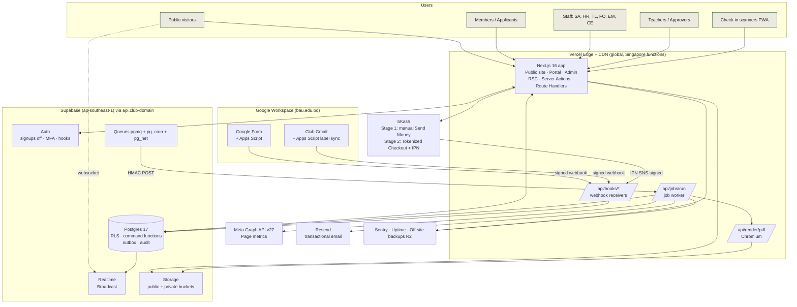
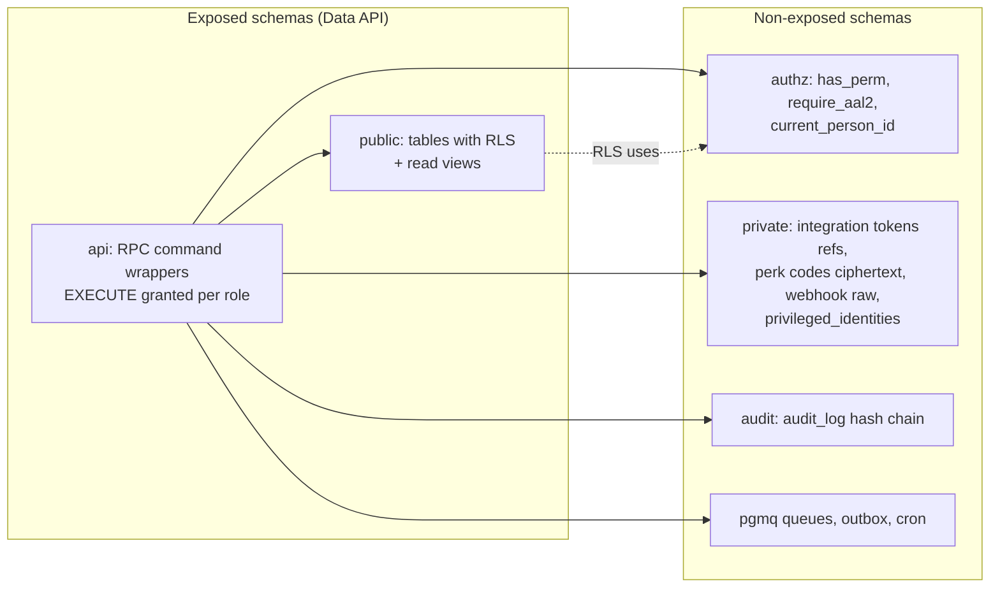
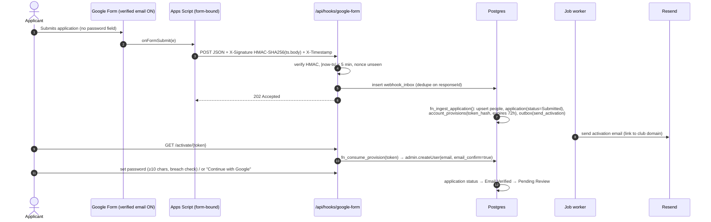
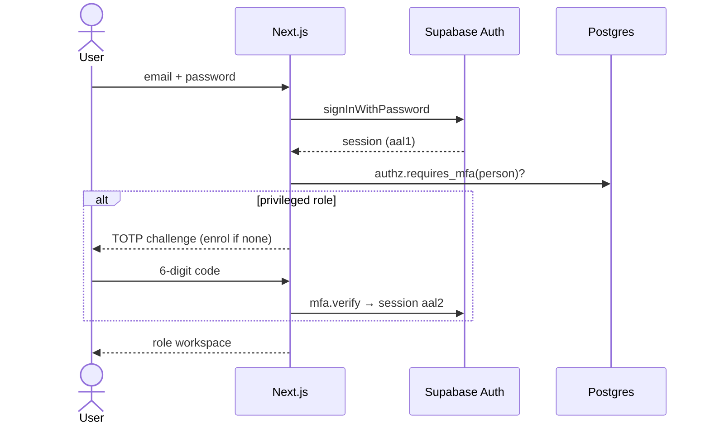
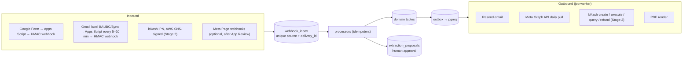
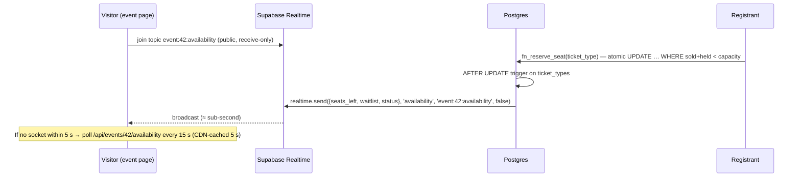
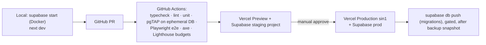

# Document 3: System Architecture

> **Recommendation in one line:** a single **Next.js 16** application (TypeScript, App Router) deployed on **Vercel Pro (Singapore)**, backed by **Supabase (Postgres 17, Auth, Storage, Realtime, Queues, Cron) in Singapore** behind a **club-owned custom API domain**. Business rules that must never be bypassed (seats, points, approvals, money, status transitions) live in **Postgres command functions under RLS**. Integrations run through a **transactional outbox and job worker**, with **Apps Script connectors** for Google Forms and Gmail in phase 1.
>
> Versions below were checked against the npm registry on **14 Nov 2026**: `next` 16.4.6, `react` 19.3.1, `typescript` 7.0.2, `tailwindcss` 4.3.5, `@supabase/supabase-js` 2.119.0, `@supabase/ssr` 0.12.7, `zod` 4.6.7, `motion` 14.14.0, `gsap` 3.15.1, `lenis` 1.3.27, `@base-ui/react` 1.9.0, `@tanstack/react-query` 5.107.1, `react-hook-form` 7.92.0, `next-intl` 4.15.1, `resend` 6.38.1, `@sentry/nextjs` 11.12.0, `playwright-core` 1.65.1, `@sparticuz/chromium` 153.0.0, `supabase` CLI 3.1.0.

## 1. Architectural principles

1. **One deployable, one database.** This is a club, not a company. Microservices would add operations burden with no benefit. The design is a modular monolith with strict module boundaries in code and schema.
2. **The database is the last line of defence.** RLS plus command functions mean that a bug in a React component or a server action cannot oversell seats, double-award points or approve one's own payment.
3. **Asynchronous by default for anything external.** Email, PDFs, Facebook sync, Gmail sync and notifications are queued jobs with retries, idempotency keys and dead-letter handling. A slow Meta API never slows down a registration.
4. **Degrade gracefully.** Public pages are statically cached and stay up during database incidents. Realtime falls back to polling. The QR scanner works offline.
5. **Boring, documented, replaceable.** Every vendor choice has an exit path (standard Postgres, S3-compatible storage, plain HTTP webhooks).

## 2. Technology decisions (ADR summaries)

Scoring: ★★★ strong, ★★ adequate, ★ weak, for this club's context.

### ADR-01: Web framework → **Next.js 16 (App Router)**

| Criterion | **Next.js 16** | React Router 7 (Remix) | Astro 5 + islands | SvelteKit 2 |
|---|---|---|---|---|
| Public site and dashboard in one codebase | ★★★ (RSC, ISR, server actions) | ★★★ | ★★ (dashboards awkward) | ★★★ |
| Ecosystem (auth helpers, UI kits, hiring pool in BD) | ★★★ | ★★ | ★★ | ★★ |
| Supabase SSR support | ★★★ (`@supabase/ssr`) | ★★ | ★★ | ★★ |
| Hosting flexibility | ★★ (best on Vercel, OpenNext elsewhere) | ★★★ | ★★★ | ★★★ |
| Long-term maintenance by student volunteers | ★★★ (most tutorials, most familiar) | ★★ | ★★ | ★★ |

**Decision.** Next.js 16.4 (the current LTS line; 16.x is active and 15.x is maintenance-only). Use Turbopack (default), the React Compiler, **Cache Components** for the public site, `proxy.ts` for session refresh, and Server Actions for mutations. **Risk:** framework churn. Mitigation: avoid experimental APIs in critical paths and pin minor versions.

### ADR-02: Backend shape → **Next.js server + Postgres command functions** (no separate API service)

- Next.js Route Handlers serve webhooks (`/api/hooks/*`), the job worker (`/api/jobs/run`), the check-in sync API and PDF rendering.
- **Postgres functions** hold invariants: `fn_reserve_seat`, `fn_confirm_registration`, `fn_transition_membership`, `fn_award_points`, `fn_decide_approval`, `fn_verify_payment`, `fn_record_execution`, `fn_check_in`. They are atomic, RLS-aware, testable with **pgTAP**, and reachable only through server code or tightly scoped RPC.
- A separate NestJS/Fastify service was rejected: it means a second deploy, a second auth context and a second set of secrets, with no capability gain at this scale. **Revisit if** a long-running worker becomes necessary (e.g. heavy PDF batches). In that case, add one small container worker (see ADR-10).

### ADR-03: Database and BaaS → **Supabase (managed Postgres)**

| Criterion | **Supabase** | Neon + Better Auth + S3 | Firebase | Self-hosted Postgres on a VPS | PocketBase |
|---|---|---|---|---|---|
| Relational integrity, constraints, transactions | ★★★ Postgres | ★★★ Postgres | ★ (document DB) | ★★★ | ★★ (SQLite) |
| Auth + MFA + hooks built in | ★★★ | ★★ (assemble yourself) | ★★★ | ★ | ★★ |
| RLS / DB-level authorisation | ★★★ | ★★ (manual) | ★★ (rules) | ★★ | ★ |
| Realtime | ★★★ (Broadcast, Presence) | ★ (add Ably/Pusher) | ★★★ | ★ | ★★ |
| Storage with signed URLs | ★★★ | ★★ (R2/S3) | ★★★ | ★ | ★★ |
| Cron + queues in DB | ★★★ (`pg_cron`, Supabase Queues/`pgmq`) | ★ | ★★ | ★★ | ★ |
| Ops burden for volunteers | ★★★ | ★★ | ★★★ | ★ (patching, backups on you) | ★★ |
| Lock-in | ★★ (standard Postgres; auth/storage portable with effort) | ★★★ | ★ | ★★★ | ★★ |
| Cost at club scale | ★★★ (Pro $25/mo) | ★★ | ★★ | ★★★ (cheap, but your time) | ★★★ |

**Decision.** Supabase **Pro** (not Free: Free projects pause after a week of inactivity and include no backups, per supabase.com/pricing as of Nov 2026). **Region:** `ap-southeast-1` (Singapore). It is closest for most Bangladeshi routes, it is the same region as the Vercel `sin1` functions, and it sits on the SEA-ME-WE cable path. Mumbai is the fallback option. **Measure RTT from Mymensingh (Grameenphone, Robi, Banglalink, BTCL) to both regions in week 1** and record the result.

**Data residency.** Hosting outside Bangladesh may be subject to the Personal Data Protection Act, 2026's cross-border provisions. This is **flagged for legal and institutional review** (Doc 8 §8). Mitigations: collect no national IDs or biometrics, minimise restricted fields, encrypt restricted columns, and record the transfer basis in the privacy notice.

### ADR-04: Authentication → **Supabase Auth** with sign-ups disabled

- **Self-sign-up is off** (dashboard toggle). As defence in depth, the **Before User Created** hook (available on Free and Pro) rejects any email that has no open `account_provisions` row. This also covers "Sign in with Google" attempts by strangers.
- **Provisioning:** the server uses the admin API to create or invite users. The activation link points to the **club domain** (custom auth domain), never to `*.supabase.co`.
- **MFA:** TOTP for privileged roles. `aal2` is checked inside Postgres for privileged commands.
- **Custom Access Token hook** adds `app_roles` (display hint only) and `person_id`. Authorisation never trusts these claims for writes (Doc 2 §1).
- Alternatives considered: Clerk (excellent UX, but per-MAU pricing at scale, a second user store and harder RLS integration), Better Auth (good, but you build MFA, hooks and admin tooling yourself) and Auth.js (no built-in MFA). Rejected for this context.

### ADR-05: Hosting → **Vercel Pro (Singapore functions)**, with an exit to Cloudflare Workers

| Criterion | **Vercel Pro** | Cloudflare Workers Paid + OpenNext | VPS (Docker) |
|---|---|---|---|
| Next.js feature fidelity (ISR, RSC, Cache Components, image optimisation) | ★★★ | ★★ (adapter lag; Node API gaps) | ★★★ (self-managed) |
| Headless Chromium for PDFs | ★★ (`@sparticuz/chromium` in a function) | ★ (needs paid Browser Rendering) | ★★★ |
| Price | $20/mo per deploying seat, includes a $20 usage credit | $5/mo minimum | $5–12/mo + your time |
| Licence fit | **Hobby is limited to personal, non-commercial use** (Vercel fair-use guidelines), so a club that collects payments should use Pro | ★★★ | ★★★ |
| Ops burden | ★★★ | ★★ | ★ |

**Decision.** Vercel Pro with one deploying seat. Other committee members get free Viewer seats or deploy via Git. **Exit path:** OpenNext on Cloudflare Workers, kept compatible by avoiding Vercel-only APIs.

### ADR-06: Background jobs → **Transactional outbox + Supabase Queues (`pgmq`) + `pg_cron` → worker route**

- Domain functions insert **outbox messages in the same transaction** as the state change (e.g. `registration.confirmed` → send ticket email, generate QR, update stats).
- `pg_cron` runs every minute. It (a) releases expired seat holds in SQL, (b) promotes waitlists, and (c) calls the worker endpoint (`pg_net` HTTP POST with an HMAC header) when queues are non-empty.
- The **worker** (`/api/jobs/run`, a Vercel function) pulls a batch with a visibility timeout and runs handlers that are **idempotent** (keyed by message ID). It retries with exponential backoff. After 8 failures a message goes to the **dead-letter queue**, which surfaces in Admin → System Health.
- **Why not Inngest/Trigger.dev now?** It would be another vendor. Inngest's free tier is 50,000 executions/month and then $99/mo (inngest.com/pricing, Nov 2026). They become worth it only if multi-step durable workflows multiply. The outbox design lets us move handlers there later without changing domain code.

### ADR-07: Realtime → **Supabase Realtime Broadcast (from database)**

- A trigger on `ticket_types` sends an aggregate payload (`seats_left`, `waitlist_count`, `status`) to a **public broadcast topic** `event:{id}:availability` via `realtime.send(...)`. No PII is ever sent.
- Supabase recommends **Broadcast over Postgres Changes for scale**, because Postgres Changes checks RLS per subscriber per change.
- Authenticated, private channels (with RLS on `realtime.messages`) are used for per-user notifications and approval-inbox counters.
- **Fallback:** if the socket is not connected within 5 s or drops, the client polls `/api/events/{id}/availability` (CDN-cached for 5 s).
- Limits on Pro: 500 peak concurrent connections included, then $10 per 1,000 (supabase.com/pricing). That is enough for normal use. During the Summit launch spike, public pages subscribe only while visible (`document.visibilityState`) and unsubscribe after 10 min idle.

### ADR-08: File storage → **Supabase Storage** (private by default), with an optional R2 offload

| Bucket | Visibility | Contents | Access |
|---|---|---|---|
| `public-media` | public (CDN) | Published images and derived variants (AVIF/WebP), EXIF stripped | Anyone |
| `private-media` | private | Originals, unpublished uploads, member photos/avatars before finalisation | Signed URL (≤ 10 min) after an RLS check |
| `evidence` | private | Task submission evidence, payment proofs, disbursement receipts | Signed URL, only for reviewers in scope |
| `documents` | private | Issued PDFs (certificates, CVs, receipts) | Owner + issuers. Public verification never exposes the file unless the owner opted in |
| `templates` | private | Certificate/CV template assets and fonts | Server only |
| `exports` | private | Generated CSV/XLSX exports, auto-deleted after 24 h | Requester only |

Image optimisation: use Next.js `<Image>` on Vercel (Pro: from $0.05 per 1,000 transformations) or Supabase image transformations (Pro: 100 origin images included, then $5 per 1,000). **Recommended:** pre-generate 3–4 widths at upload time in the worker (sharp) and serve them statically. That is cheapest and fastest.

### ADR-09: Email → **Resend** for transactional mail. Gmail for *ingestion only*

- Send from `notify@<club-domain>` with SPF, DKIM and DMARC (`p=quarantine` after monitoring). Resend Free allows 3,000/month **but only 100/day** (resend.com/pricing). Recruitment and Summit weeks will exceed 100/day, so plan for **Resend Pro ($20/mo, 50,000/mo)** during peak months, or Amazon SES ($0.10 per 1,000) if someone can operate AWS.
- Gmail/Workspace SMTP is **not** used for bulk sending (daily caps, deliverability coupling with the university domain).

### ADR-10: PDF generation → **HTML/CSS templates rendered by headless Chromium**

- Bangla needs correct **complex-script shaping** (conjuncts, reordered vowel signs, reph). Chromium shapes with HarfBuzz, which is reliable. JS PDF libraries (react-pdf/fontkit, pdf-lib) have weaker or unverified Indic shaping. **Spike DOC-S1** must confirm with a test set of 50 real Bangla names before this ADR is final.
- **Runtime:** `playwright-core` + `@sparticuz/chromium` inside a Vercel function (memory 1–2 GB) for single documents. For batch issuance (e.g. 400 Summit certificates), the worker processes chunks of 20 per invocation. If cold-start or memory limits bite, move rendering to **one small container** (Gotenberg or a Playwright service on a $5–7/mo VPS or Cloud Run) behind an HMAC-authenticated endpoint.
- Every PDF is stored with its SHA-256 hash, template version and data snapshot.

### ADR-11: Data access and migrations → **SQL-first migrations (Supabase CLI) + generated types + supabase-js**

- `supabase/migrations/*.sql` is the single source of truth. Types come from `supabase gen types typescript`.
- Reads in Server Components use `supabase-js` **with the user's session**, so RLS applies. Privileged writes use `rpc('fn_...')`.
- No Prisma or Drizzle runtime in the request path. An ORM that connects as a privileged role would silently bypass RLS. (Drizzle may be used for type-safe *queries* only if it runs as the `authenticated` role with JWT claims set, which is not needed initially.)
- DB tests: **pgTAP** via `supabase test db`.

### ADR-12: UI stack

| Concern | Choice | Why |
|---|---|---|
| Styling | Tailwind CSS 4.3 with CSS-variable design tokens (OKLCH) | Fast, consistent, themeable |
| Primitives | **Base UI 1.9** (accessible, unstyled) via a shadcn-style local component registry | Full visual control and good accessibility. Components are owned in-repo |
| Forms | react-hook-form 7 + Zod 4 (shared schemas client and server) | One validation source |
| Data tables | TanStack Table + server pagination | Dashboards |
| Client data | TanStack Query 5 (dashboards), RSC for everything else | Optimistic updates where safe |
| Motion | **Motion 14** for UI and layout transitions. **GSAP 3.15 + ScrollTrigger** for public-site scroll storytelling. **Lenis** smooth scroll on capable desktops only | See Doc 6 §7 |
| Charts | Recharts for routine dashboard charts. Custom SVG for signature visuals (growth rings, seat plots) | — |
| i18n | next-intl 4 (UI strings). Bilingual content fields in DB | — |
| Icons | Lucide + custom agri-business glyph set | — |
| QR | `qrcode` (render), `@zxing/browser` / native `BarcodeDetector` (scan) | Works on low-end Android |

### ADR-13: Observability

Sentry (Developer free tier: 5,000 errors/mo, 1 cron monitor, then Team $29/mo) for errors, tracing and cron monitors. Vercel logs + Supabase logs. Better Stack or UptimeRobot (free) for uptime and status pages. A custom **System Health** page shows queue depth, the DLQ, integration token status, the last backup and the last restore drill.

### ADR-14: Network resilience for Bangladesh

- In Feb 2026, Indian ISPs DNS-blocked `*.supabase.co` for several days under a government order. Access was reported restored on 4 Mar 2026. A similar block in Bangladesh would take down any app that calls `*.supabase.co` from the browser.
- **Mitigation:** Supabase **custom domain** add-on ($10/mo per project) → `api.<club-domain>`. All browser traffic (auth, realtime, storage URLs) then goes to the club's own domain. Auth emails link to the club domain.
- The marketing site keeps serving from the Vercel CDN even if the API is unreachable.
- The check-in PWA is offline-capable.

## 3. High-level architecture



## 4. Frontend architecture

```
apps/web/src/app
├── (site)/[locale]/            ← public website (static/ISR, Cache Components)
│   ├── page.tsx                  Home
│   ├── about/  events/[slug]/  members/  advisors/  wings/[slug]/
│   ├── insights/[series]/[slug]/  gallery/  resources/  contact/
│   ├── join/                     recruitment landing (links to active intake)
│   └── verify/[code]/            certificate verification
├── (auth)/[locale]/login | activate/[token] | reset | mfa
├── (portal)/[locale]/app/        ← authenticated; layout picks role workspace
│   ├── home/                     role-aware overview
│   ├── applicant/ …              application progress, info requests
│   ├── member/ …                 tasks, points, events, certificates, CV, perks
│   ├── teacher/ …                notices, documents, dues, approvals (mandate)
│   ├── hr/ … lead/ …             tasks, review queue, team performance
│   ├── events/ … finance/ …      staff modules (permission-gated)
│   └── admin/ …                  membership, RBAC, CMS, integrations, audit, settings
├── scan/                         ← check-in PWA (offline-first, own manifest)
└── api/
    ├── hooks/google-form | gmail | bkash-ipn | meta
    ├── jobs/run                  worker (HMAC)
    ├── render/pdf                internal (HMAC)
    └── events/[id]/availability  cached JSON fallback
```

- **Server Components by default.** Client components only for interactivity (forms, scanner, charts, motion).
- **Module boundaries:** `src/modules/{membership,tasks,points,events,finance,cms,documents,integrations,identity}` each expose `queries.ts` (RLS reads), `commands.ts` (RPC wrappers + Zod), `ui/` and `jobs/`. Cross-module calls go through public module APIs only (enforced by ESLint `boundaries`).
- **Caching:** public content uses `"use cache"` with tags (`event:{id}`, `page:{slug}`). CMS publish calls `revalidateTag`. Personalised and portal routes are dynamic and never cached.
- **PWA:** the scanner and member ticket view work offline via a service worker. The public site uses no service worker, so stale content cannot get stuck.

## 5. Backend and database architecture



- **Secrets** (bKash app secret, Meta tokens, Apps Script HMAC keys, Resend key) live in **Vercel encrypted env vars** and, where the DB needs them (e.g. `pg_net` HMAC), in **Supabase Vault**. Never in tables readable through the API.
- **Encryption of restricted columns** (phones, guardian contact, payee account numbers): application-level envelope encryption (AES-256-GCM, key in env/Vault), plus a deterministic HMAC "blind index" column for exact-match lookups such as duplicate detection by phone.
- **Audit:** every command function writes `audit.audit_log(actor, action, entity, before, after, request_id, prev_hash, hash)` in the same transaction. A daily job exports the day's last hash to off-site storage, so tampering is detectable.

## 6. Authentication architecture

### 6.1 Provisioning and activation (replaces "password from Google Form")



- A nightly **reconciliation job** reads the form's linked Sheet (Sheets API, read-only, via the same Apps Script or a service account the club owns) and re-ingests any response whose ID is missing in `applications`. This guards against Apps Script trigger failures, since Apps Script does not retry a failed fetch on its own.

### 6.2 Login with MFA for privileged users



## 7. Integration architecture



Common rules for every connector:
- **Authenticity:** HMAC (Apps Script), SNS signature (bKash IPN) or `X-Hub-Signature-256` (Meta). Reject anything unsigned.
- **Idempotency:** a unique delivery key, so a replayed event is a no-op.
- **Minimal payload:** only the fields a processor needs. Raw payloads are kept 30 days in `private.webhook_raw`, then purged.
- **Health:** `integration_connections.last_success_at`. An alert fires when it is stale beyond 2× the expected interval.

## 8. Background job architecture

| Job | Trigger | Idempotency key | Retry | On final failure |
|---|---|---|---|---|
| `email.send` | outbox | `notification_id:channel` | 8× exp. backoff | DLQ + admin alert |
| `ticket.issue` (QR + email) | `registration.confirmed` | `registration_id` | 8× | DLQ |
| `holds.expire` | cron 1 min | — (set-based SQL) | n/a | Sentry cron monitor |
| `waitlist.promote` | cron 1 min + on release | `ticket_type_id:seq` | n/a | — |
| `pdf.render` | outbox / batch | `document_id:version` | 3× | Mark document `render_failed` |
| `meta.sync_daily` | cron 03:10 BST | `date` | 3× | Integration health red |
| `gmail.ingest` | webhook | `message_id` | n/a (inbox) | — |
| `forms.reconcile` | cron 02:40 BST | `response_id` | — | Report diff |
| `dues.generate` | cron 1st of month 00:15 BST | `plan_id:period` | 3× | Alert FO |
| `reminders.tasks` | cron hourly | `assignment_id:kind:day` | — | — |
| `audit.anchor` | cron daily | `date` | 3× | Alert SA |
| `backup.offsite` | GitHub Action nightly | `date` | 2× | Alert SA |
| `retention.purge` | cron weekly | `policy_id:week` | — | Report |

## 9. Realtime architecture



What "real-time" means per feature:

| Feature | Class | Mechanism | Expected latency |
|---|---|---|---|
| Seats left / sold out | Real-time | Broadcast from DB | < 1–3 s |
| Approval inbox counters, notifications | Real-time | Private Broadcast channel per user | < 3 s |
| Task status in dashboards | Near-real-time | Refetch on focus + private channel events | seconds |
| Gmail-derived items | Near-real-time | Apps Script every 5–10 min (Phase 1); Pub/Sub push (target) | 5–10 min / ~seconds |
| Facebook Page metrics | **Scheduled** | Daily pull; Meta updates most insights every 24 h | 24–48 h |
| Leaderboards | Scheduled | Recomputed on ledger insert, cached 5 min | ≤ 5 min |

## 10. Deployment architecture and environments



| Environment | Supabase | Vercel | Data |
|---|---|---|---|
| Local | Docker (`supabase start`) | `next dev` | Seed fixtures (synthetic, no real PII) |
| Staging | Separate Pro-org project (second compute ≈ +$10/mo) **or** a Free project for pre-launch testing only | Preview deployments | Synthetic data only |
| Production | Pro project, custom domain | Production | Real |

- **Migrations:** forward-only, reviewed. Expand/contract for breaking changes. Run **after** an on-demand backup.
- **Rollback:** the Vercel instant rollback covers app code. DB changes are rolled forward with a fix migration, and a restore is the last resort.
- **Secrets:** Vercel env (prod and preview separated), GitHub Actions secrets for CI. No secrets in the repo (enforced by GitHub secret scanning + `gitleaks` in CI).

## 11. Monitoring and backup architecture

| Layer | Tooling | Alert target |
|---|---|---|
| Uptime (public site, API domain, worker heartbeat) | Better Stack / UptimeRobot (free) | Email + Telegram/WhatsApp-compatible webhook to SAs |
| Errors and traces | Sentry | SA + developer on duty |
| Cron and jobs | Sentry cron monitors + `job_runs` table + DLQ page | SA |
| Integrations | `integration_connections` health + daily digest | SA |
| Security events | `auth_audit` (failed logins, MFA changes), privileged changes feed | Both SAs (always) |
| Backups | Supabase daily (Pro, 7 days) + **nightly encrypted `pg_dump` to Cloudflare R2** (30 daily + 12 monthly) + Storage bucket sync weekly | SA |
| Restore drills | Quarterly: restore the latest off-site dump into staging, run smoke tests, record RTO | SA |

## 12. Security boundaries summary

| Boundary | Control |
|---|---|
| Internet → Vercel | TLS 1.2+, HSTS, CSP (nonce-based), Vercel Firewall rate limits on `/login`, `/api/hooks/*`, registration endpoints |
| Browser → Supabase | Publishable key only. RLS on all exposed tables. Custom domain. Realtime public topics carry only aggregates |
| Next.js → Supabase privileged | Secret key server-only (never in client bundles; CI greps the build output for key prefixes) |
| External → webhooks | Signature verification, timestamp window, replay cache, payload size limits, 202-then-process |
| Worker → external APIs | Least-privilege tokens, per-integration secrets, timeouts (bKash: 30 s per their docs), circuit breakers |
| Staff → privileged actions | MFA (aal2), SoD in DB, second-SA confirmation for privileged changes, full audit |

## 13. Repository layout (proposed)

```
baubc_website/
├── apps/web/                  Next.js 16 app (site + portal + api)
├── packages/ui/               design tokens, Base UI wrappers, motion presets
├── packages/domain/           Zod schemas, state machine definitions shared FE/BE
├── packages/pdf-templates/    certificate/CV/receipt HTML templates + fonts
├── supabase/
│   ├── migrations/            0001_extensions.sql … per domain
│   ├── tests/                 pgTAP: rls_*.sql, fn_*.sql, invariants_*.sql
│   ├── seed/                  synthetic fixtures
│   └── functions/             (only if an Edge Function is needed)
├── integrations/apps-script/  google-form-connector.gs, gmail-label-sync.gs (+ clasp config)
├── docs/blueprint/            this blueprint
└── .github/workflows/         ci.yml, backup.yml, lighthouse.yml
```
