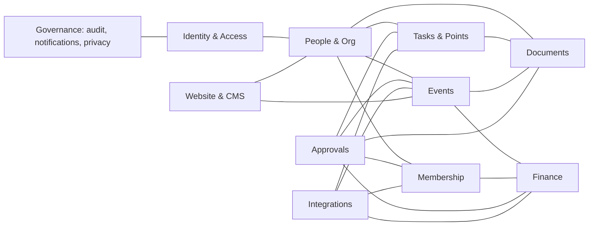
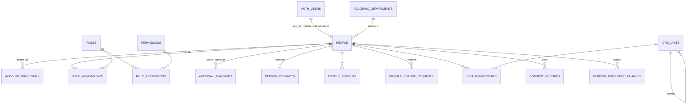
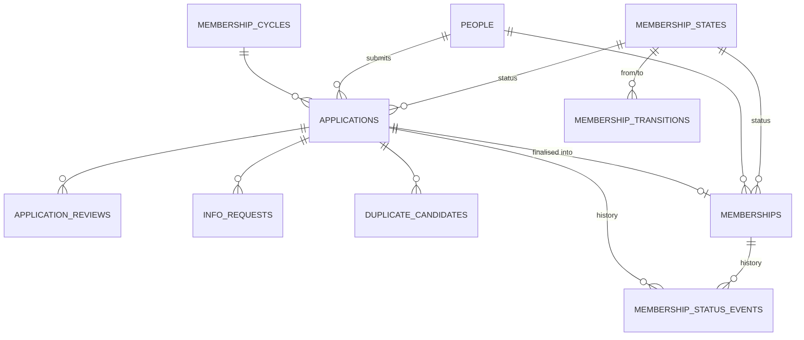
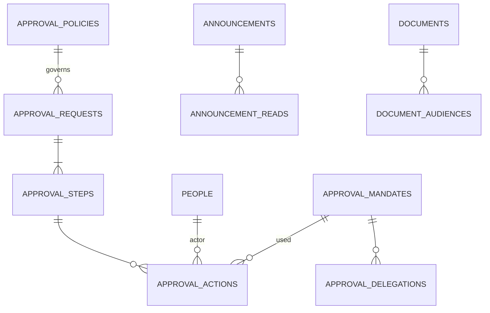
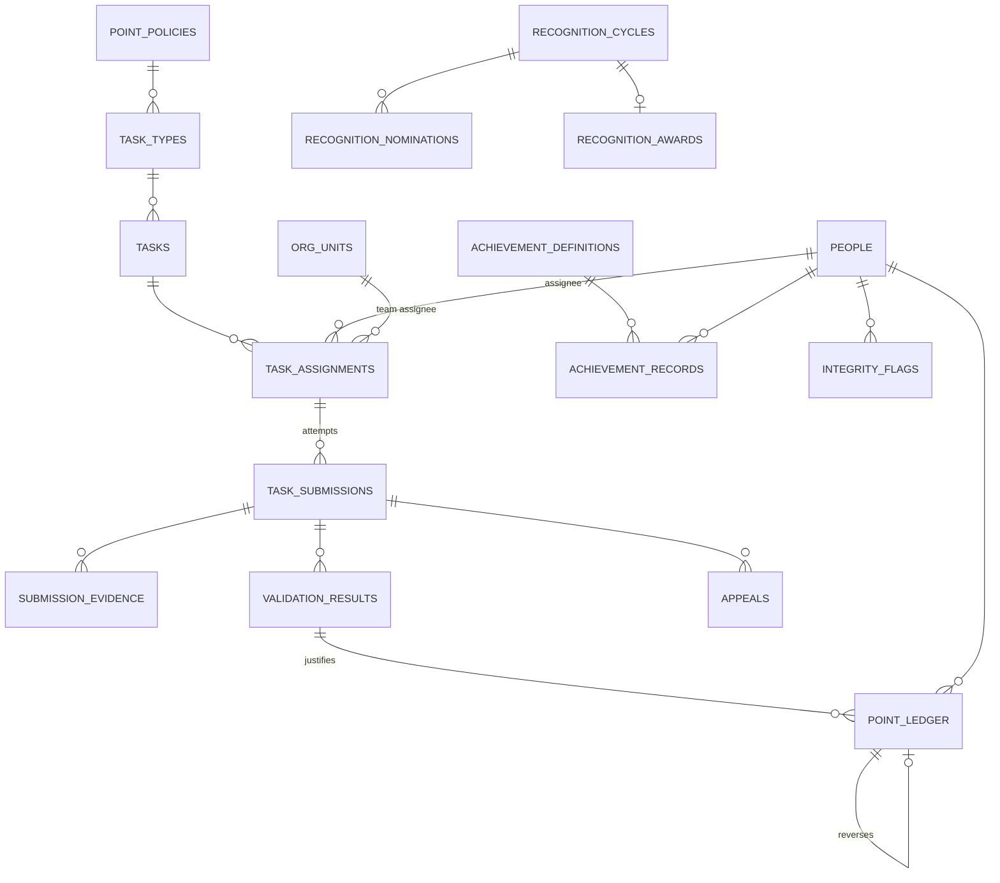
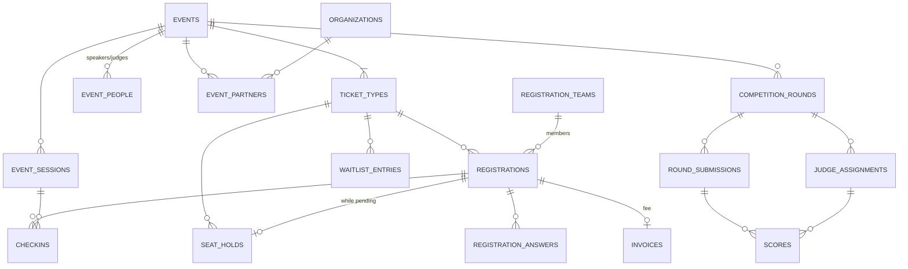
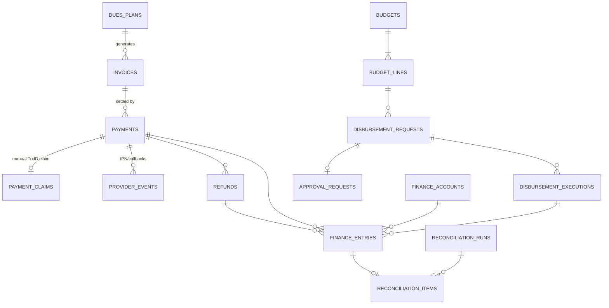
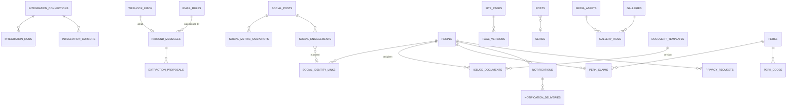

# Document 4: Database Design

> PostgreSQL 17 on Supabase. The schema is designed from **entities → relationships → invariants → access rules**, then normalised and consolidated. The brief's 90+ proposed entities are merged into **≈ 75 tables** in 10 domains (for example, `departments` + `teams` become `org_units`; `notices` + `announcements` + `public_announcements` become `announcements` with an audience; `payment_requests` + `expenses` + `reimbursements` become `disbursement_requests` with a `kind`).

## 1. Conventions

| Topic | Convention |
|---|---|
| Keys | `id uuid primary key default gen_random_uuid()`. Human-facing codes (member no., certificate no., invoice no.) are separate unique columns |
| Time | `timestamptz` everywhere, stored in UTC and displayed in Asia/Dhaka (BST, UTC+6). `created_at`, `updated_at` (trigger) on mutable tables |
| Money | `numeric(12,2)` + `currency char(3) default 'BDT'`. No floats. All amounts are calculated server-side |
| Bilingual text | `jsonb` shaped `{"en": "...", "bn": "..."}` with a CHECK that `en` exists. Helper `i18n(col, locale)` |
| Enumerations | Postgres `enum` only for stable sets (e.g. `scope_type`). **Configurable states live in tables** (`membership_states`, `task_states`) with FKs |
| Soft delete | `archived_at` only for content (pages, posts, events). **Never** for ledgers, histories, approvals or payments, which are append-only |
| Append-only | `BEFORE UPDATE OR DELETE` trigger raises an exception. No UPDATE/DELETE grants to `authenticated` |
| Classification | Each column group is tagged with a `COMMENT` such as `classification:restricted`. Tags are **P** public, **I** internal, **C** confidential, **R** restricted |
| Restricted columns | Encrypted at application level (`*_enc bytea`) + blind index (`*_bidx bytea`) for equality search |
| Naming | snake_case, plural table names, `fn_` command functions, `v_` views |
| RLS | Enabled on **every** table in `public`. The default is deny. Policies are named `{table}_{action}_{who}` |

## 2. Schemas

| Schema | Exposed via Data API | Contents |
|---|---|---|
| `public` | Yes (RLS on all) | Domain tables and read views |
| `api` | Yes (functions only) | Thin RPC wrappers callable by `authenticated`/`anon` with explicit `GRANT EXECUTE` |
| `authz` | No | `has_perm`, `current_person_id`, `require_aal2`, SoD helpers |
| `private` | No | `privileged_identities`, `integration_secrets_ref`, `webhook_raw`, `perk_codes`, `encryption_keys_meta` |
| `audit` | No | `audit_log` (hash-chained), `auth_audit` |
| `ops` | No | `outbox`, `job_runs`, `dead_letters`, `cron` metadata (pgmq queues live in `pgmq`) |

## 3. Entity-relationship diagrams

### 3.1 Context map (domains)



### 3.2 Identity, people and organisation



### 3.3 Membership



### 3.4 Approvals and teacher portal



`approval_requests.subject_type/subject_id` is a **polymorphic link** (membership decision, disbursement, refund, event publish, points award, document batch). Integrity is protected by a per-type FK column (`disbursement_request_id`, `refund_id`, ...) with a CHECK that exactly one is set. This avoids the usual polymorphic-FK weakness.

### 3.5 Tasks, points, achievements



### 3.6 Events and competitions



### 3.7 Finance



### 3.8 Integrations, CMS, documents, perks, governance



## 4. Table specifications

Notation in "Access": **own** = row belongs to the current person. **scope** = permission within unit or event. Full rules are in Doc 2.

### 4.1 Identity and access

#### `people` (core person record, exists before or without an auth account)
| Column | Type | Constraints / notes | Class |
|---|---|---|---|
| id | uuid | PK | I |
| user_id | uuid | UNIQUE, FK → `auth.users(id)` ON DELETE SET NULL. Null until activation | I |
| kind | text | CHECK in (`student`,`teacher`,`external`,`staff`) | I |
| full_name | jsonb | `{en, bn}`, **verified field** | P* |
| display_name | text | user-editable | P* |
| primary_email | citext | UNIQUE (normalised lower-case). Verified on activation | C |
| student_id | text | UNIQUE where not null. Format CHECK (configurable regex). **Verified field** | C |
| academic_department_id | uuid | FK `academic_departments`. Verified | I |
| academic_session | text | e.g. `2023-24`. Verified | I |
| batch_level | text | e.g. `Level 2 Semester 1`. Verified | I |
| photo_asset_id | uuid | FK `media_assets` (private until approved) | C |
| avatar_asset_id | uuid | FK `media_assets`. Illustrated character alternative | P* |
| bio | jsonb | user-editable, moderated | P* |
| facebook_url / linkedin_url | text | URL CHECK. Display only | P* |
| interests, skills | text[] | self-declared | P* |
| status | text | `active`,`suspended`,`deactivated` (account-level) | I |
| verified_fields_locked_at | timestamptz | after finalisation, verified columns need a correction request | I |
| created_at / updated_at | timestamptz | | I |

`P*` means public **only** when the owner's visibility setting allows it and membership is finalised.
Indexes: `(lower(primary_email))`, `(student_id)`, trigram on `full_name->>'en'` (duplicate search), `(academic_department_id, academic_session)`.
Guard: a trigger blocks changes to verified columns unless the caller is `fn_apply_profile_change()`.
Retention: kept while a member or alumni. Applicants who are rejected are anonymised 24 months after cycle close (configurable).

#### Other identity tables

| Table | Purpose | Key fields | Constraints / indexes | Access | Retention |
|---|---|---|---|---|---|
| `person_contacts` | Restricted contact data | person_id PK/FK, phone_enc, phone_bidx, personal_email_enc, guardian_name_enc, guardian_phone_enc | UNIQUE(phone_bidx) where not null (duplicate detection) | own; `people.read_restricted` | As `people` |
| `academic_departments` | BAU faculties/departments (reference) | id, faculty, name{en,bn}, code | UNIQUE(code) | public read | Permanent |
| `roles` | Role catalogue | key PK, name{en,bn}, is_privileged, requires_mfa, assignable_by text[] | — | read: authenticated | Permanent |
| `permissions` | Permission catalogue | key PK, description, risk_level | — | read: authenticated | Permanent |
| `role_permissions` | Role→permission | role_key, permission_key | PK(role_key, permission_key) | read: authenticated. Write: SA via fn + ² | Permanent, audited |
| `role_assignments` | Who holds which role, where | id, person_id, role_key, scope_type enum(`global`,`unit`,`event`), scope_id, valid_from, valid_until, granted_by, confirmed_by, revoked_at, revoke_reason | Partial UNIQUE(person_id, role_key, scope_type, scope_id) where revoked_at is null. CHECK(granted_by ≠ person_id) | own; `rbac.manage` | Permanent (history) |
| `approval_mandates` | Teacher Approver and finance decision rights | id, person_id, categories text[], max_amount_bdt numeric, valid_from, valid_until, granted_by, confirmed_by, revoked_at | CHECK(granted_by ≠ person_id) | own; SA | Permanent |
| `approval_delegations` | Temporary delegation | mandate_id, delegate_person_id, starts_at, ends_at | CHECK(delegate ≠ mandate holder) | own; SA | Permanent |
| `pending_privileged_changes` | Two-SA confirmation queue | id, change_type, payload jsonb, requested_by, expires_at (72 h), confirmed_by, confirmed_at, rejected_at | CHECK(confirmed_by ≠ requested_by) | SA | Permanent |
| `account_provisions` | Invitations / activation | id, person_id, email, source (`google_form`,`admin_invite`,`event_guest`), token_hash bytea, expires_at, consumed_at, created_by | UNIQUE(token_hash). Partial UNIQUE(email) where consumed_at is null | server only | Purge consumed after 90 days |
| `account_status_events` | Suspension / reactivation history | person_id, from, to, actor, reason, created_at | append-only | own; SA | Permanent |
| `private.privileged_identities` | Allowlist for bootstrap and privileged roles | email, role_key, status, verified_at, mfa_enrolled_at | UNIQUE(email, role_key) | service only | Permanent |
| `consent_records` | Consent per purpose | person_id, purpose, notice_version, granted_at, withdrawn_at, channel | Partial UNIQUE(person_id, purpose) where withdrawn_at is null | own; `privacy.handle` | Permanent (proof) |
| `profile_visibility` | Field-group visibility | person_id, field_group, level (`public`,`members`,`private`) | PK(person_id, field_group) | own | As people |

### 4.2 Organisation

| Table | Purpose | Key fields | Constraints / indexes | Access | Retention |
|---|---|---|---|---|---|
| `org_units` | Wings, departments, teams (club structure) | id, parent_id, kind (`wing`,`department`,`team`,`committee`), slug, name{en,bn}, description{en,bn}, is_public, archived_at | UNIQUE(slug). No cycles (trigger) | public read when `is_public` | Permanent |
| `unit_memberships` | Positions in units over time | id, person_id, unit_id, position_title{en,bn}, is_lead, term_label (`2026-27`), started_at, ended_at, verified_by, verified_at | Partial UNIQUE(person_id, unit_id) where ended_at is null | public read when the person opted in; write via fn | Permanent (CV source) |

### 4.3 Membership

#### `applications`
| Column | Type | Notes |
|---|---|---|
| id | uuid PK | |
| cycle_id | uuid FK `membership_cycles` | |
| person_id | uuid FK `people` | |
| source | text | `google_form`, `native_form`, `admin` |
| source_response_id | text | **UNIQUE(source, source_response_id)**: idempotent intake |
| form_schema_version | int | maps answers to the questions asked |
| answers | jsonb | snapshot of submitted answers (no password fields ever. The intake processor drops unknown keys) |
| preferred_units | uuid[] | ranked |
| status_key | text FK `membership_states(key)` | changed only via `fn_transition_membership` |
| duplicate_of | uuid FK `applications` | set by an admin after review |
| submitted_at, email_verified_at | timestamptz | |
| assigned_reviewer_id | uuid FK `people` | |

Indexes: `(cycle_id, status_key)`, `(person_id)`, GIN on `answers` (jsonb_path_ops) for admin filters.
Constraint: **one live application per person per cycle**, via partial UNIQUE(cycle_id, person_id) where status not in terminal states.

#### `membership_status_events` (append-only, a decision record per the brief)
| Column | Type | Notes |
|---|---|---|
| id | bigint identity PK | |
| application_id / membership_id | uuid | exactly one set (CHECK) |
| from_state, to_state | text FK `membership_states` | |
| actor_person_id | uuid FK | the decision maker (null = system, with `actor_kind='system'`) |
| actor_role_snapshot | text[] | roles at decision time |
| mandate_id | uuid | if decided by a Teacher Approver |
| reason_code | text | from a configurable list |
| reason_text | text | required for reject, suspend, withdraw |
| notes | text | internal |
| evidence_asset_ids | uuid[] | |
| batch_id | uuid | for bulk actions |
| created_at | timestamptz default now() | |

#### Other membership tables

| Table | Purpose | Key fields | Constraints / indexes | Access | Retention |
|---|---|---|---|---|---|
| `membership_cycles` | Annual recruitment | id, label (`2026-27`), kind (`general`,`executive`), opens_at, closes_at, intake_form_url, form_schema jsonb, rubric jsonb, status | Partial UNIQUE(kind) where status='open' | public read (open cycle basics) | Permanent |
| `membership_states` | Configurable states | key PK, label{en,bn}, category (`applicant`,`member`,`former`), is_terminal, counts_as_member, publicly_listable, sort | — | read all | Permanent |
| `membership_transitions` | Allowed transitions | from_key, to_key, required_permission, requires_reason, requires_mfa, requires_approval_policy_id, notify_template | PK(from_key, to_key) | read staff. Write SA ² | Permanent |
| `memberships` | Official membership | id, person_id, application_id, member_no (`BAUBC-YYYY-NNNN`), status_key, finalized_at, joined_unit_id, ended_at, end_reason | UNIQUE(member_no). Partial UNIQUE(person_id) where status counts_as_member | own; staff | Permanent |
| `application_reviews` | Review/interview scores | application_id, reviewer_id, rubric_scores jsonb, recommendation, conflict_declared bool, notes | UNIQUE(application_id, reviewer_id) | reviewers in scope | 24 months after cycle |
| `info_requests` | Additional-info loop | application_id, requested_by, message, due_at, response jsonb, responded_at | — | own; reviewers | With application |
| `duplicate_candidates` | Suspected duplicates | application_id, other_application_id, signals jsonb (email/phone/student_id/name similarity), resolution, resolved_by | UNIQUE(pair) | reviewers | With application |
| `profile_change_requests` | Corrections of verified data | person_id, field_path, old_value jsonb, new_value jsonb, reason, evidence_asset_id, status, reviewer_id, decided_at | — | own; `people.verify` | Permanent |

### 4.4 Approvals and communications

| Table | Purpose | Key fields | Constraints / indexes | Access | Retention |
|---|---|---|---|---|---|
| `approval_policies` | Rules: which subject, which thresholds, how many steps | id, subject_type, condition jsonb (e.g. `amount > 2000`), steps jsonb (`[{approver: 'teacher_approver', category:'finance_disbursement', min:1}, {approver:'teacher_approver', min:1, distinct:true}]`), version, active | Versioned (new row per change) | read staff. Write SA ² | Permanent |
| `approval_requests` | One decision process | id, policy_id, policy_version, subject_type, (one of) membership_application_id / disbursement_request_id / refund_id / event_id / points_award_id / document_batch_id, requested_by, status (`pending`,`approved`,`rejected`,`returned`,`clarification`,`cancelled`,`expired`), amount_bdt, context jsonb (snapshot shown to approvers), due_at | CHECK(num_nonnulls(subject FKs)=1). Index (status, due_at) | requester; eligible approvers (mandate category) | Permanent |
| `approval_steps` | Steps within a request | request_id, step_no, approver_kind, category, min_approvals, distinct_from_steps int[], status | UNIQUE(request_id, step_no) | as request | Permanent |
| `approval_actions` | Each decision (append-only) | id, step_id, actor_person_id, action (`approve`,`reject`,`clarify`,`return`,`comment`), note, mandate_id, aal, created_at | **UNIQUE(request_id, actor_person_id) for approve/reject**. CHECK(actor ≠ requested_by) via fn | as request | Permanent |
| `announcements` | Notices and announcements (internal and public) | id, title{en,bn}, body{en,bn} (sanitised blocks), audience jsonb (`{public:true}` or `{roles:[..], units:[..]}`), channels text[] (`in_app`,`email`), pinned, publish_at, expires_at, author_id | Index (publish_at) | by audience | 3 years, then archive |
| `announcement_reads` | Read receipts | announcement_id, person_id, read_at | PK(both) | own; author | 1 year |
| `documents` | Shared files (assigned documents, resources, reports) | id, title{en,bn}, category, asset_id, audience jsonb, version, supersedes_id | — | by audience | Per category |

### 4.5 Tasks, points and achievements

#### `point_ledger` (append-only, the source of truth for points)
| Column | Type | Notes |
|---|---|---|
| id | bigint identity PK | |
| person_id | uuid FK `people` NOT NULL | |
| amount | integer NOT NULL | CHECK(amount <> 0). Negative only for `reversal`/`penalty` |
| kind | text | `task_award`, `event_attendance`, `achievement_bonus`, `adjustment`, `penalty`, `reversal` |
| category | text | e.g. `operations`, `content`, `events`, `social`, `leadership` (for caps and analytics) |
| source_type, source_id | text, uuid | e.g. `task_submission` |
| validation_result_id | uuid FK `validation_results` | **NOT NULL for task_award**. CHECK by kind |
| approval_request_id | uuid FK | required above the policy threshold and for adjustments |
| reverses_entry_id | bigint FK `point_ledger(id)` | UNIQUE (an entry can be reversed only once) |
| reason | text NOT NULL | |
| awarded_by | uuid FK `people` | |
| period_month | date | `date_trunc('month', effective_at)`, used for monthly boards |
| effective_at | timestamptz | |
| created_at | timestamptz default now() | |

Invariants: (1) `UNIQUE(source_type, source_id, person_id, kind) WHERE kind='task_award'` prevents double award. (2) An append-only trigger. (3) The `point_balances` summary (person_id, period_month, category, total) is maintained by an AFTER INSERT trigger. A nightly job recomputes and compares, and alerts on drift.

#### Other task tables

| Table | Purpose | Key fields | Constraints / indexes | Access | Retention |
|---|---|---|---|---|---|
| `task_types` | Templates of work | key PK, name{en,bn}, validation_mode (`auto`,`human`,`hybrid`), evidence_schema jsonb, auto_rules jsonb, default_points, max_points, second_review_above, appeal_window_days, max_attempts, category | CHECK(default_points ≤ max_points) | read staff/members | Permanent |
| `tasks` | A unit of work | id, type_key, title{en,bn}, description, instructions, priority, starts_at, due_at, expected_output, evidence_requirements jsonb, points, approval_required, assignment_mode (`individual`,`team`,`open_claim`), max_claims, scope_unit_id, event_id, status_key, created_by | CHECK(points ≤ type max unless approval_request set). Index (status_key, due_at), (scope_unit_id) | scope; assignees | 3 years |
| `task_states` / `task_transitions` | Configurable lifecycle per type | as membership equivalents + `type_key` | PK(type_key, from, to) | staff | Permanent |
| `task_assignments` | Who must do it | id, task_id, assignee_person_id **or** assignee_unit_id, assigned_by, status_key, accepted_at, extension_until | CHECK(num_nonnulls(person, unit)=1). UNIQUE(task_id, assignee_person_id) | assignee; scope | 3 years |
| `task_submissions` | Attempts | id, assignment_id, submitted_by, attempt_no, content jsonb, content_sha256, submitted_at, is_late, status (`submitted`,`validation_pending`,`revision_requested`,`approved`,`rejected`), locked_at | UNIQUE(assignment_id, attempt_no). Immutable after `locked_at` (trigger) | own; reviewers | 3 years (evidence 1 year after approval unless an achievement references it) |
| `submission_evidence` | Files and links | submission_id, kind (`file`,`link`,`screenshot`,`form_ref`,`checkin_ref`), asset_id, url, sha256, phash (64-bit perceptual hash), url_status | Index (sha256), (phash) for duplicate detection | as submission | As submission |
| `validation_results` | Every auto or human check | id, submission_id, validator_kind (`rule`,`human`), rule_key, reviewer_id, outcome (`pass`,`fail`,`flag`,`approve`,`reject`,`revise`), score, rubric jsonb, comment, created_at | append-only | own (outcome + comment); reviewers | 3 years |
| `appeals` | Appeal on rejection | submission_id, filed_by, reason, status, decided_by, decision_note | CHECK(decided_by ≠ original reviewer) via fn | own; HR | 3 years |
| `point_policies` | Caps and diminishing returns | category, monthly_cap, repeat_decay jsonb, second_review_threshold | — | read members (published) | Permanent |
| `achievement_definitions` | Types of recognition | key, kind (`position`,`award`,`badge`,`contribution`,`leadership`), name{en,bn}, issuer_permission | — | public read | Permanent |
| `achievement_records` | Locked achievements | id, person_id, definition_key, title{en,bn}, description, occurred_on, event_id, unit_id, evidence_ids uuid[], issued_by, verified_by, verified_at, status (`active`,`revoked`), revoked_by, revoke_reason, visibility | Immutable except revoke fields (trigger). CHECK(verified_by ≠ person_id) | own; public if visible | Permanent |
| `recognition_cycles` / `recognition_nominations` / `recognition_awards` | Monthly Best Member | cycle(period, criteria jsonb, status); nomination(cycle, nominee, nominated_by, rationale, metrics_snapshot jsonb); award(cycle UNIQUE, person, approval_request_id, citation{en,bn}, certificate_id) | One award per cycle (UNIQUE) | staff; public after publish | Permanent |
| `integrity_flags` | Anti-gaming signals | id, person_id, kind (`dup_hash`,`near_dup_image`,`velocity`,`reviewer_affinity`,`random_audit`), details jsonb, status, resolved_by | — | HR, SA | 3 years |

### 4.6 Events and competitions

#### `ticket_types` (the inventory, the heart of overselling prevention)
| Column | Type | Notes |
|---|---|---|
| id | uuid PK | |
| event_id | uuid FK | |
| name | jsonb | `{en,bn}` e.g. "Student pass", "Team (3–5)" |
| audience | text | `public`, `members`, `bau_students`, `invite` |
| unit | text | `person` or `team` (a team ticket consumes 1 seat unit **or** N seats, configurable) |
| seats_per_unit | int | e.g. 1, or team size for venue-seat accounting |
| price | numeric(12,2) | 0 = free |
| capacity | int | CHECK(capacity ≥ 0) |
| sold_count | int default 0 | confirmed registrations |
| held_count | int default 0 | active holds |
| **CHECK** | | `sold_count + held_count <= capacity` and both ≥ 0 |
| waitlist_enabled | bool | |
| per_person_limit | int default 1 | |
| sales_start_at / sales_end_at | timestamptz | |
| hold_minutes_online | int default 15 | PGW checkout |
| hold_minutes_manual | int default 1440 | manual bKash verification window |

Capacity changes go through `fn_set_capacity(ticket_type, new_capacity)`. It refuses if `new_capacity < sold_count` and otherwise logs the change and triggers waitlist promotion when capacity grows.

#### `registrations`
| Column | Type | Notes |
|---|---|---|
| id | uuid PK | |
| event_id, ticket_type_id | uuid FK | |
| person_id | uuid FK nullable | null for external guests |
| guest_name, guest_email (citext), guest_phone_enc, guest_institution | | guests only |
| identity_key | text NOT NULL | normalised email (or phone bidx) → **UNIQUE(event_id, identity_key) WHERE status in ('pending','confirmed')** prevents duplicates |
| team_id | uuid FK `registration_teams` | |
| status | text | `pending_payment`, `pending_verification`, `confirmed`, `waitlisted`, `cancelled`, `expired`, `refunded` |
| source | text | `online`, `admin`, `offline_walkin`, `import` |
| invoice_id | uuid FK | when paid |
| ticket_code_hash | bytea UNIQUE | SHA-256 of a 128-bit random code. The code itself is shown only to the registrant |
| manage_token_hash | bytea UNIQUE | guest self-service link |
| answers_version | int | |
| consent | jsonb | photo consent, data use |
| confirmed_at, cancelled_at, cancel_reason | | |
| created_at, idempotency_key (UNIQUE) | | double-click and retry safety |

#### Other event tables

| Table | Purpose | Key fields | Constraints / indexes | Access | Retention |
|---|---|---|---|---|---|
| `events` | Event record | id, slug, title{en,bn}, subtitle, body (blocks), category (`summit`,`case_competition`,`pitch`,`olympiad`,`hackathon`,`workshop`,`talk`,`social`), status (`draft`,`pending_approval`,`published`,`registration_closed`,`ongoing`,`completed`,`cancelled`,`archived`), visibility, venue jsonb (name, address, geo), starts_at, ends_at, reg_opens_at, reg_closes_at, eligibility jsonb, contact jsonb, banner_asset_id, organizer_unit_id, refund_policy jsonb, seo jsonb | UNIQUE(slug). CHECK(ends_at ≥ starts_at), CHECK(reg_closes_at ≤ ends_at) | public when published | Permanent (archive) |
| `event_sessions` | Days, tracks, rounds | event_id, title, starts_at, ends_at, room, checkin_required | — | public | Permanent |
| `event_people` | Speakers, judges, mentors, hosts | event_id, person_id or external_profile jsonb, role, bio{en,bn}, photo_asset_id, sort, public | — | public if `public` | Permanent |
| `organizations` | Partners, sponsors, vendors, universities | id, name, kind, website, logo_asset_id, contact_enc, logo_usage_permitted | — | public subset | Permanent |
| `event_partners` | Partner on event | event_id, organization_id, tier, sort | PK(event, org) | public | Permanent |
| `seat_holds` | Temporary reservations | id, ticket_type_id, registration_id UNIQUE, units, expires_at, released_at, release_reason (`expired`,`confirmed`,`cancelled`,`failed_payment`) | Index (expires_at) WHERE released_at is null | server only | 90 days |
| `waitlist_entries` | Queue | id, ticket_type_id, identity_key, person_id, guest contact, position (bigint identity), status (`waiting`,`offered`,`accepted`,`expired`,`removed`), offered_at, offer_expires_at | UNIQUE(ticket_type_id, identity_key) where status in (waiting, offered) | own; EM | 90 days after event |
| `registration_teams` | Team registrations | id, event_id, name, captain_registration_id, invite_code_hash, min_size, max_size, locked_at | UNIQUE(event_id, lower(name)) | members of team; EM | With event |
| `registration_answers` | Event-specific questions | registration_id, question_key, answer jsonb | PK(both) | own; EM | 1 year after event |
| `checkins` | Attendance (append-only) | id, registration_id, session_id, scanned_by, device_id, method (`qr`,`manual`,`offline_sync`), scanned_at (device time), received_at, result (`ok`,`duplicate`,`invalid`,`wrong_event`) | **Partial UNIQUE(registration_id, session_id) WHERE result='ok'** (single use per session) | EM; own | Permanent (attendance proof) |
| `competition_rounds` | Rounds | event_id, name, opens_at, closes_at, rubric jsonb, max_score, results_published_at | — | public after publish | Permanent |
| `round_submissions` | Team deliverables | round_id, team_id, asset_ids, submitted_at, sha256 | UNIQUE(round_id, team_id) | team; assigned judges | Permanent |
| `judge_assignments` | Who judges what | round_id, judge_person_id, team_id, conflict_declared | UNIQUE(round, judge, team) | judge; EM | Permanent |
| `scores` | Rubric scores | assignment_id, criterion_key, score, comment, locked_at | UNIQUE(assignment_id, criterion_key). Immutable after lock | judge; EM | Permanent |
| `results` | Final standings | round_id, team_id, rank, total_score, approval_request_id | UNIQUE(round_id, rank) | public after publish | Permanent |

### 4.7 Finance

#### `payments` (one row per attempt to settle an invoice)
| Column | Type | Notes |
|---|---|---|
| id | uuid PK | |
| invoice_id | uuid FK NOT NULL | |
| method | text | `bkash_send_money_manual`, `bkash_pgw`, `cash`, `bank_transfer` |
| amount | numeric(12,2) | must equal the invoice balance due (or a configured partial rule) |
| status | text | `initiated`, `claimed`, `pending_verification`, `verified`, `failed`, `rejected`, `refunded`, `partially_refunded`, `reconciliation_required` |
| provider | text | `bkash` |
| provider_payment_id | text | PGW `paymentID` |
| provider_trx_id | text | bKash TrxID. **UNIQUE(provider, provider_trx_id)** across all payments (blocks TrxID reuse) |
| payer_wallet_bidx / payer_wallet_last4 | bytea / text | restricted |
| idempotency_key | text UNIQUE | from client and invoice |
| claimed_at, verified_at, verified_by, second_verified_by | | SoD-4 enforced |
| receiving_account_id | uuid FK `finance_accounts` | which wallet or box |
| raw_ref | uuid FK `private.webhook_raw` | for PGW callbacks |

#### Other finance tables

| Table | Purpose | Key fields | Constraints / indexes | Access | Retention |
|---|---|---|---|---|---|
| `invoices` | Receivables | id, invoice_no UNIQUE, payer_person_id or guest ref, purpose (`event_fee`,`dues`,`membership_fee`,`workshop_fee`,`other`), registration_id, dues_plan_id, period, amount, currency, status (`open`,`paid`,`void`,`refunded`), due_at | UNIQUE(dues_plan_id, payer_person_id, period) | own; FO | **≥ 5 years** (financial record + PDPA record-keeping guidance) |
| `payment_claims` | Manual TrxID claim detail | payment_id PK/FK, trx_id, sender_wallet_last4, claimed_amount, claimed_paid_at, screenshot_asset_id, notes | trx_id format CHECK (alphanumeric, length 8–12, configurable) | own; FO | 5 years |
| `provider_events` | bKash callbacks and IPN | id, provider, event_type, dedupe_key UNIQUE, signature_valid, payment_id, received_at, processed_at | — | FO | 5 years |
| `refunds` | Refunds | id, payment_id, amount, reason, status (`requested`,`approved`,`processing`,`completed`,`failed`,`rejected`), approval_request_id, provider_refund_trx_id, executed_by | CHECK(amount > 0). Function ensures sum ≤ refundable | payer (own); FO | 5 years |
| `dues_plans` | Recurring fees | id, audience jsonb (role `teacher`), amount (default 500.00), frequency (`monthly`), starts_on, active | — | FO; payer reads own plan | Permanent |
| `disbursement_requests` | Outgoing money (vendor, expense, reimbursement, prize, other) | id, request_no UNIQUE, kind, purpose, amount, payee_kind, payee_person_id / payee_org_id, payee_account_enc, payee_account_last4, method_planned, budget_line_id, evidence_asset_ids, event_id, requested_by, status (`draft`,`submitted`,`pending_approval`,`approved`,`rejected`,`pending_execution`,`processing`,`successful`,`failed`,`cancelled`,`refunded`,`reconciliation_required`), duplicate_check_hash | Index on (payee, amount, date) to detect duplicates | requester; approvers; FO | 5 years |
| `disbursement_executions` | Actual payout record | id, request_id, executed_by, method, provider_trx_id, amount, executed_at, proof_asset_id, verified_by, verified_at | UNIQUE(method, provider_trx_id). SoD-3 | FO; SA | 5 years |
| `finance_accounts` | Wallets, cash box, bank | id, name, kind (`bkash_personal`,`bkash_merchant`,`cash`,`bank`), identifier_last4, custodian_person_id, active | — | FO; SA | Permanent |
| `finance_entries` | Append-only cash book | id, account_id, direction (`in`,`out`), amount, occurred_at, payment_id / execution_id / refund_id, memo, created_by | append-only. CHECK exactly one source or `manual_journal` with approval | FO; SA | 5+ years |
| `budgets` / `budget_lines` | Plan vs actual | budget(fiscal_year, status); line(budget_id, category, unit_id, event_id, amount) | — | FO, SA, TA read | 5 years |
| `reconciliation_runs` / `reconciliation_items` | Statement matching | run(account_id, period, statement_asset_id, imported_by, status); item(run_id, statement_line jsonb, finance_entry_id, match_status (`matched`,`unmatched_statement`,`unmatched_ledger`,`amount_mismatch`), resolved_by, note) | Reconciler ≠ executor (fn) | FO; SA | 5 years |

### 4.8 Integrations

| Table | Purpose | Key fields | Constraints / indexes | Access | Retention |
|---|---|---|---|---|---|
| `integration_connections` | Each connected account | id, provider (`google_form`,`gmail_appsscript`,`gmail_api`,`meta_page`,`bkash_pgw`,`resend`), label, status (`active`,`degraded`,`expired`,`revoked`), scopes text[], secret_ref (Vault id), token_expires_at, last_success_at, last_error, owner_person_id | — | SA; `integration.read` | Permanent |
| `integration_cursors` | Sync positions | connection_id, cursor_key (`historyId`, `since`), value | PK(connection_id, cursor_key) | server | Permanent |
| `integration_runs` | Job outcomes | id, connection_id, job, started_at, finished_at, status, items_in, items_out, error | Index (connection_id, started_at desc) | SA | 90 days |
| `webhook_inbox` | All inbound deliveries | id, source, delivery_id, received_at, signature_valid, status (`received`,`processed`,`rejected`,`failed`), processed_at, error, raw_ref | **UNIQUE(source, delivery_id)** | server; SA | 90 days |
| `private.webhook_raw` | Raw payloads (encrypted) | id, payload_enc, purge_after | — | service only | 30 days |
| `inbound_messages` | Gmail items (labelled subset only) | id, gmail_message_id UNIQUE, thread_id, from_email, from_name, subject, received_at, labels text[], snippet (≤ 300 chars), category, rule_id, linked_entity jsonb, body_stored bool, retention_until | Index (category, received_at) | `integration.review` + category reviewers | 180 days default (configurable); body only if needed |
| `email_rules` | Categorisation rules | id, priority, conditions jsonb (from/domain/subject regex/label), category, extract_template, active | — | SA | Permanent |
| `extraction_proposals` | Proposed records from email | id, inbound_message_id, target_type (`contact_inquiry`,`sponsor_lead`,`event_application`,`speaker`,`payment_notice`), proposed jsonb, confidence, status (`proposed`,`accepted`,`edited_accepted`,`rejected`), reviewer_id, created_entity_ref | — | reviewers | 1 year |
| `social_posts` | Page posts | id, platform (`facebook`), external_id UNIQUE, permalink, post_type, published_at, caption_excerpt, series_id, campaign_tag | — | staff; public subset | Permanent |
| `social_metric_snapshots` | Insights over time | post_id or page-level null, metric_name, period, value numeric, captured_at, api_version | UNIQUE(post_id, metric_name, period, captured_at::date) | staff | 3 years |
| `social_identity_links` | Member ↔ page-scoped ID | person_id, platform, external_scoped_id, link_method (`comment_code`), link_code_hash, verified_at, revoked_at | UNIQUE(platform, external_scoped_id) where not revoked | own; SA | Until unlinked + 30 days |
| `social_engagements` | Observed engagement events | id, post_id, external_actor_scoped_id, kind (`comment`,`reaction`), external_ref, occurred_at, matched_person_id | UNIQUE(post_id, kind, external_ref) | staff; own (matched) | 1 year |
| `social_contributions` | Verified contribution records (point source) | id, person_id, task_submission_id, post_id, contribution_type, evidence_url, validation_method (`api_match`,`evidence_review`,`qr`), verification_status, reviewer_id, points_entry_id | Immutable after verification | own; HR | 3 years |

### 4.9 Website, CMS and media

| Table | Purpose | Key fields | Constraints / indexes | Access | Retention |
|---|---|---|---|---|---|
| `site_pages` | Block-based pages | id, slug UNIQUE, title{en,bn}, blocks jsonb (validated by Zod schema version), status (`draft`,`scheduled`,`published`), publish_at, seo jsonb, current_version | — | public when published; CE | Permanent |
| `page_versions` | History | page_id, version, blocks, edited_by, created_at | UNIQUE(page_id, version) | CE | Last 50 versions |
| `series` | DECODED, Case Studies, etc. | id, slug, title{en,bn}, description, cover_asset_id | UNIQUE(slug) | public | Permanent |
| `posts` | Blog, insights, episodes | id, slug, series_id, episode_no, title{en,bn}, excerpt, body jsonb (blocks), cover_asset_id, author_person_ids, status, published_at, facebook_post_id, seo | UNIQUE(slug). UNIQUE(series_id, episode_no) | public when published | Permanent |
| `taxonomy_terms` / `post_terms` | Categories and tags | term(kind, slug, label{en,bn}); link(post_id, term_id) | — | public | Permanent |
| `media_assets` | Media library | id, bucket, path, visibility (`public`,`private`), mime, bytes, width, height, sha256, alt{en,bn}, caption{en,bn}, credit, category, event_id, variants jsonb, exif_stripped bool, uploaded_by, consent_ref | UNIQUE(bucket, path). CHECK(visibility='private' OR alt->>'en' is not null) | public if public; uploader; CE | Originals permanent for public archive; private evidence per its parent |
| `galleries` / `gallery_items` | Albums | gallery(slug, title, event_id, cover); item(gallery_id, asset_id, sort) | — | public | Permanent |
| `navigation_items` | Menus | menu_key, label{en,bn}, href or page_id, parent_id, sort, visible | — | public | Permanent |
| `site_settings` | CMS settings and feature flags | key PK, value jsonb, updated_by | — | public read for non-sensitive keys | Permanent |
| `contact_inquiries` | Contact form submissions | id, category, name, email, org, message, status, assigned_to, spam_score | Index (status) | SA, assigned | 2 years |

### 4.10 Documents and perks

| Table | Purpose | Key fields | Constraints / indexes | Access | Retention |
|---|---|---|---|---|---|
| `document_templates` | Certificate, CV, letter and receipt templates | id, kind, name, version, html, css, fields_schema jsonb, page_size, approved_by, approved_at, status | UNIQUE(kind, name, version). Immutable once approved | SA, CE | Permanent |
| `issued_documents` | Every issued document | id, kind, serial_no UNIQUE (`BAUBC-CERT-2027-000123`), verification_code UNIQUE (≥ 80-bit random, base32), template_id, recipient_person_id / guest name, subject_ref (event_id / achievement_id / unit_membership_id / payment_id), data_snapshot jsonb, pdf_asset_id, sha256, issued_by, approval_request_id, issued_at, revoked_at, revoked_by, revoke_reason | CHECK(qualifying subject_ref present for its kind) | recipient; issuers; public view (minimal) | Permanent |
| `v_document_verification` | Public projection | serial_no, kind, recipient display name, title, issued_at, status | View with `security_invoker`, rate-limited endpoint | public | — |
| `cv_snapshots` | Annual CV data | person_id, year, sections jsonb (verified data only + flags for self-declared), approved_by_member_at, document_id | UNIQUE(person_id, year, version) | own | Permanent |
| `perks` | Benefits catalogue | id, title{en,bn}, partner_org_id, description, terms, distribution_proof_asset_id, eligibility jsonb, mode (`link`,`shared_code`,`unique_codes`,`request`), starts_at, ends_at, quantity, status | CHECK(distribution_proof_asset_id is not null when status='active') | eligible members | Until expiry + 1 year |
| `private.perk_codes` | Code pool | id, perk_id, code_enc, status, assigned_claim_id | — | service only | Until expiry + 90 days |
| `perk_claims` | Claims | id, perk_id, person_id, claimed_at, code_id, revealed_at | UNIQUE(perk_id, person_id) | own; SA | 1 year |

### 4.11 Governance

| Table | Purpose | Key fields | Constraints / indexes | Access | Retention |
|---|---|---|---|---|---|
| `audit.audit_log` | Tamper-evident log of sensitive actions | id bigint, occurred_at, actor_person_id, actor_kind, action, entity_type, entity_id, before jsonb (redacted), after jsonb (redacted), request_id, ip_hash, ua_hash, prev_hash, hash = sha256(prev_hash ‖ row) | append-only. Index (entity_type, entity_id), (actor_person_id, occurred_at) | SA (all); FO (finance subset); own decisions | **≥ 5 years** |
| `audit.auth_audit` | Auth security events | user_id, event (`login_ok`,`login_fail`,`mfa_enrol`,`mfa_fail`,`password_reset`,`session_revoked`), ip_hash, at | — | SA; own | 1 year |
| `notifications` | In-app notifications | id, person_id, type, title{en,bn}, body, link, dedupe_key, created_at, read_at | **UNIQUE(person_id, dedupe_key)** (no spam) | own | 180 days |
| `notification_deliveries` | Channel deliveries | notification_id, channel, provider_message_id, status, attempts, last_error | UNIQUE(notification_id, channel) | SA | 90 days |
| `notification_preferences` | Per-type preferences | person_id, type, channels | PK | own | — |
| `notification_templates` | Bilingual templates | key, channel, subject{en,bn}, body{en,bn}, version | — | SA | Permanent |
| `ops.outbox` | Transactional outbox | id, topic, payload jsonb, dedupe_key UNIQUE, created_at, dispatched_at | — | service | 30 days |
| `ops.job_runs` / `ops.dead_letters` | Job execution and DLQ | — | — | SA | 90 days |
| `system_settings` | Operational settings (thresholds, fees, retention) | key, value, sensitive bool, updated_by | sensitive changes via SoD-8 | SA | Permanent |
| `retention_policies` | Data lifecycle | entity, retention, action (`delete`,`anonymise`,`archive`), legal_basis | — | SA | Permanent |
| `privacy_requests` | Data subject requests | id, person_id, kind (`access`,`correction`,`erasure`,`withdraw_consent`,`objection`), status, received_at, due_at, handled_by, outcome | — | own; `privacy.handle` | 5 years |
| `incidents` | Security and privacy incidents | id, severity, detected_at, description, affected_entities, notified_authority_at, notified_subjects_at, closed_at | — | SA | 5 years |
| `bulk_operations` | Bulk action batches | id, kind, filter jsonb, count, confirmed_by, executed_at | — | SA | Permanent |

## 5. Critical invariants as SQL (illustrative)

```sql
-- 5.1 Seat reservation: atomic, no overselling, no client math
create function api.reserve_seat(p_ticket_type uuid, p_identity_key text, p_idem text)
returns uuid language plpgsql security definer set search_path = '' as $$
declare v_reg uuid; v_tt public.ticket_types; v_minutes int;
begin
  -- idempotent retry: same key returns the same registration
  select id into v_reg from public.registrations where idempotency_key = p_idem;
  if found then return v_reg; end if;

  update public.ticket_types
     set held_count = held_count + seats_per_unit
   where id = p_ticket_type
     and now() between sales_start_at and sales_end_at
     and sold_count + held_count + seats_per_unit <= capacity
  returning * into v_tt;                       -- row lock + check in one statement
  if not found then
    raise exception 'SOLD_OUT_OR_CLOSED' using errcode = 'P0001';  -- caller offers waitlist
  end if;

  v_minutes := case when v_tt.price = 0 then 10 else v_tt.hold_minutes_online end;
  insert into public.registrations(event_id, ticket_type_id, identity_key, status, idempotency_key, person_id)
  values (v_tt.event_id, v_tt.id, p_identity_key,
          case when v_tt.price = 0 then 'pending_verification' else 'pending_payment' end,
          p_idem, authz.current_person_id())
  returning id into v_reg;                     -- unique(event_id, identity_key) blocks duplicates

  insert into public.seat_holds(ticket_type_id, registration_id, units, expires_at)
  values (v_tt.id, v_reg, v_tt.seats_per_unit, now() + make_interval(mins => v_minutes));
  return v_reg;
end $$;

-- 5.2 Expire holds (pg_cron every minute), set-based and race-safe
with expired as (
  update public.seat_holds h set released_at = now(), release_reason = 'expired'
   where h.released_at is null and h.expires_at < now()
  returning h.ticket_type_id, h.units, h.registration_id
), dec as (
  update public.ticket_types t set held_count = t.held_count - e.total
    from (select ticket_type_id, sum(units) total from expired group by 1) e
   where t.id = e.ticket_type_id
)
update public.registrations r set status = 'expired'
  from expired e where r.id = e.registration_id and r.status in ('pending_payment','pending_verification');

-- 5.3 Append-only guard (ledger, histories, approvals, audit, finance entries)
create function ops.forbid_mutation() returns trigger language plpgsql as $$
begin raise exception 'APPEND_ONLY: % is immutable', tg_table_name; end $$;
create trigger point_ledger_immutable before update or delete on public.point_ledger
  for each row execute function ops.forbid_mutation();

-- 5.4 TrxID can never be claimed twice (any status, any invoice)
create unique index payments_trx_unique on public.payments(provider, provider_trx_id)
  where provider_trx_id is not null;
```

## 6. High-risk relationships and duplication analysis

| Risk | Where | Mitigation |
|---|---|---|
| A person exists twice (e.g. applied with Gmail, later invited with a `@bau.edu.bd` address) | `people` | Duplicate candidates on student_id / phone blind index / name+session trigram. A manual merge function re-points FKs in one transaction and logs the merge |
| `auth.users` deleted → orphaned records | `people.user_id` | `ON DELETE SET NULL`. Never cascade-delete people. Deactivate instead |
| Polymorphic approval subject | `approval_requests` | Typed nullable FKs + `num_nonnulls = 1` CHECK |
| Points total drifting from ledger | `point_balances` | Derived only. Nightly recompute and compare. Never written by app code |
| Seat counters drifting from registrations | `ticket_types.sold/held` | Nightly reconciliation query: `sold_count = count(confirmed)*units`, `held_count = sum(active holds)`. Auto-alert, and fix via an audited function |
| Same payment confirmed by both a manual claim and the PGW | `payments` | Invoice-level lock: `fn_mark_invoice_paid` uses `SELECT … FOR UPDATE` on the invoice. A second verified payment becomes `reconciliation_required` → refund flow |
| Membership status in two places (application vs membership) | `applications.status_key`, `memberships.status_key` | A single transition function updates both atomically. States are partitioned by category, so an applicant state is never valid on `memberships` (CHECK via FK subset view) |
| Copies of personal data in integrations | `inbound_messages`, `webhook_raw` | Minimal snippets, encryption, 30–180 day purge |
| Bilingual names inconsistent between certificate and profile | `issued_documents.data_snapshot` | Snapshot at issue time (intended). Corrections trigger reissue, never in-place edits |

## 7. Indexing strategy (summary)

- FKs are always indexed. Composite indexes match dashboard filters: `(cycle_id, status_key)`, `(event_id, status)`, `(person_id, period_month)`, `(status, due_at)`.
- Partial unique indexes express business uniqueness ("one live X per Y").
- `pg_trgm` for fuzzy name search. GIN on frequently filtered jsonb keys only.
- RLS helper functions are `STABLE`, and policies call `(select authz.current_person_id())` so the planner caches it per statement (Supabase RLS performance guidance).
- Load-test the RLS-heavy queries (approval inbox, ledger, registrations list) at 10× the expected data.

## 8. Migration strategy

1. **Tooling:** Supabase CLI. `supabase/migrations/YYYYMMDDHHMMSS_<domain>_<change>.sql`. Generated types are committed.
2. **Order of initial migrations:**
   `0001_extensions` (pgcrypto, citext, pg_trgm, pg_cron, pg_net, pgmq, supabase_vault) → `0002_schemas_and_roles` → `0003_authz_functions` → `0004_identity` → `0005_org` → `0006_membership` → `0007_approvals` → `0008_cms_media` → `0009_events` → `0010_finance_core` → `0011_tasks_points` → `0012_documents` → `0013_integrations` → `0014_notifications_audit` → `0015_rls_policies` → `0016_command_functions` → `0017_cron_jobs` → `0018_seed_reference_data` (roles, permissions, states, transitions, task types) → `0019_bootstrap_lock`.
3. **Rules:** never edit an applied migration. Every migration is forward-only and idempotent where possible. Destructive changes use **expand → migrate data → contract**, spread over two releases.
4. **Gates:** CI runs all migrations on an empty DB, the seed, the full pgTAP suite (RLS matrix + invariants) and a "dump → restore → diff" check. Production migrations run only after a fresh backup and in a low-traffic window (never during an open event registration peak).
5. **Data fixes** are migrations too (`…_datafix_…sql`) with an audit entry. No ad-hoc SQL in production except under break-glass, which is logged.

## 9. Data retention summary

| Data | Default retention | Action | Basis |
|---|---|---|---|
| Rejected/withdrawn applications | 24 months after cycle close | Anonymise (keep aggregates) | Purpose limitation |
| Finance records (invoices, payments, disbursements, entries) | ≥ 5 years | Keep | Financial accountability; PDPA record-keeping (per secondary sources, see Doc 8) |
| Audit log | ≥ 5 years | Keep (archive older than 2 years to cold storage) | Accountability |
| Gmail snippets / bodies | 180 days / only when needed | Delete | Minimisation |
| Webhook raw payloads | 30 days | Delete | Minimisation |
| Task evidence | 1 year after approval (unless referenced by an achievement or certificate) | Delete files, keep hashes | Minimisation |
| Event registration answers | 1 year after event | Delete | Minimisation |
| Notifications | 180 days | Delete | — |
| Exports | 24 hours | Delete | Security |
| Member and alumni records | While a member/alumni + until an erasure request (subject to legal holds) | — | Consent / legitimate purpose |

All retention values live in `retention_policies` and **must be approved by the club's advisors** after the legal review in Doc 8.
