# Document 5: Workflow Specifications

> Every workflow is a **state machine whose transitions run only inside a Postgres command function**. A function checks permission, separation-of-duties (SoD) rules and preconditions, writes the new state and a history/audit row, and emits outbox events (notifications, jobs). All of this happens in one transaction. States and transitions marked *configurable* are stored in tables and can be changed by Super Admins (with a second Super Admin's confirmation) without a deploy.

| WF | Workflow | Main function(s) |
|---|---|---|
| WF-1 | Application intake and account provisioning | `fn_ingest_application`, `fn_consume_provision` |
| WF-2 | Membership approval lifecycle | `fn_transition_membership` |
| WF-3 | Generic approval engine (teacher approvals) | `fn_open_approval`, `fn_decide_approval` |
| WF-4 | Task lifecycle | `fn_transition_task`, `fn_submit_task` |
| WF-5 | Task validation (auto + human) | `fn_record_validation`, `fn_review_submission` |
| WF-6 | Points award, adjustment, reversal | `fn_award_points`, `fn_reverse_points` |
| WF-7 | Achievements and Monthly Best Member | `fn_issue_achievement`, `fn_decide_recognition` |
| WF-8 | Event lifecycle | `fn_transition_event` |
| WF-9 | Registration and seat reservation | `fn_reserve_seat`, `fn_confirm_registration`, `fn_cancel_registration`, `fn_promote_waitlist` |
| WF-10 | Incoming payments (manual bKash and PGW) | `fn_claim_payment`, `fn_verify_payment`, `fn_pgw_*` |
| WF-11 | Disbursements (maker-checker) | `fn_submit_disbursement`, `fn_record_execution`, `fn_reconcile_item` |
| WF-12 | Refunds | `fn_request_refund`, `fn_complete_refund` |
| WF-13 | Gmail ingestion | `fn_ingest_message`, `fn_accept_proposal` |
| WF-14 | Facebook engagement validation | `fn_link_social_identity`, `fn_match_engagement` |
| WF-15 | Certificate and document generation | `fn_issue_document`, `fn_revoke_document` |
| WF-16 | Profile correction requests | `fn_request_profile_change`, `fn_apply_profile_change` |
| WF-17 | Check-in | `fn_check_in` |
| WF-18 | Perk claim | `fn_claim_perk` |
| WF-19 | Privacy (data subject) requests | `fn_open_privacy_request` |

---

## WF-1: Application intake and account provisioning

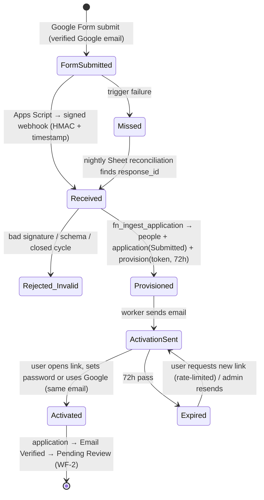

| Step | Rule |
|---|---|
| Intake fields | Per PRD MEM-03. **No password field.** The processor rejects any payload key matching `/pass(word)?|pin|otp/i` and alerts admins |
| Verified email | Form setting "Collect email addresses: **Verified**" (respondent signs in with Google). Non-Google email users use the native form (P1), which sends a 6-digit email OTP before submission |
| Idempotency | `UNIQUE(source, source_response_id)` on applications. A re-delivered webhook returns 200 with no change |
| Existing person | If the email or student ID matches an existing `people` row, link to it and create a new application (if the cycle allows) or flag a duplicate |
| Closed cycle | Response stored with status `late_submission` for admin decision. No provision is sent |
| Activation | Token: 32 random bytes, base64url, stored as SHA-256. Single use. Expires 72 h after issue. The link is on the club domain |
| After activation | The person can log in and sees the **Applicant workspace** only |
| Failure handling | Webhook endpoint down → Apps Script logs the failure to a "Failed" sheet tab and retries on the next trigger. Nightly reconciliation catches the rest. Email bounce → admin sees "activation undeliverable" and can correct the email after verifying identity |

## WF-2: Membership approval lifecycle (configurable)

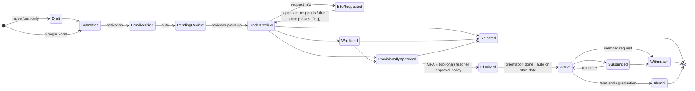

**Transition table (defaults, stored in `membership_transitions`):**

| From → To | Permission | Reason required | MFA | Approval policy | Side effects |
|---|---|---|---|---|---|
| Pending Review → Under Review | `membership.review` | — | — | — | Assign reviewer |
| Under Review → Info Requested | `membership.review` | Message | — | — | Create `info_requests`. Notify the applicant with a due date |
| Under Review → Provisionally Approved | `membership.decide` | Optional | — | — | Notify. Optionally create an orientation task |
| Under Review → Waitlisted | `membership.decide` | Yes | — | — | Notify with an honest status |
| Any open → Rejected | `membership.decide` | **Yes** (reason code + text) | — | — | Notify (respectful template). Schedule anonymisation per retention |
| Provisionally Approved → Finalized | `membership.finalize` | — | **Yes** | Optional (e.g. "Teacher Approver confirms finalised list") | Issue `member_no`. Lock verified fields. Grant computed `member` role. Generate membership certificate (WF-15). Add to directory if opted in |
| Finalized → Active | `membership.finalize` or system | — | — | — | — |
| Active → Suspended | `membership.suspend` | **Yes** | **Yes** | — | Pause tasks and claims. Hide from directory. Notify |
| Suspended → Active | `membership.suspend` | **Yes** | **Yes** | — | Restore |
| Active → Withdrawn | member self-service or SA | Yes | — | — | Keep history. Hide from directory |
| Active → Alumni | `membership.decide` (bulk) | — | — | — | Read-only access. Keeps certificates and CV |

**Rules.** A decision maker cannot decide their own application. Bulk transitions run through the same function per record inside one transaction with a `batch_id`. Every transition writes `membership_status_events` with the decision maker, timestamp, previous status, new status, reason, notes and evidence.

**Wrong decision recovery.** There are no deletions. Admins use an explicit reverse transition (e.g. Rejected → Under Review, with permission `membership.config`, reason "decision reversed" and MFA), so the history shows both the error and the fix.

## WF-3: Generic approval engine (teacher approvals)

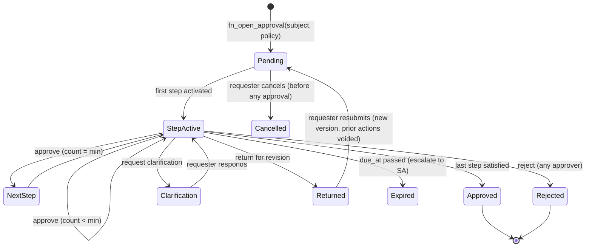

- **Policy evaluation:** at open time, the matching `approval_policies` row (by subject type and conditions such as amount) is **snapshotted** (`policy_version`). Later policy edits never affect in-flight requests.
- **Eligibility to decide:** the actor needs (a) a live mandate covering the category with `max_amount_bdt ≥ amount`, (b) not to be the requester, (c) not to have already acted on this request, (d) aal2 for finance and membership finalisation.
- **Context shown to approvers:** purpose, amount, budget line and remaining budget, evidence files (signed URLs), requester and their history, similar past requests (duplicate hint), and the policy rule being applied.
- **Notifications:** new step → in-app + email to eligible approvers (deduplicated). 48 h reminder. Escalation to SAs at `due_at`.
- **Default financial policy** (configurable, to be approved by advisors):

| Disbursement amount (BDT) | Steps |
|---|---|
| ≤ 2,000 | 1 Teacher Approver (finance mandate) |
| 2,001–20,000 | 2 distinct approvers: Teacher Approver + (Teacher Approver or Super Admin) |
| > 20,000 or any prize / cash advance | 2 distinct Teacher Approvers + Super Admin acknowledgement |
| Policy or threshold change | 2 Super Admins (SoD-8) |

## WF-4: Task lifecycle (configurable per task type)

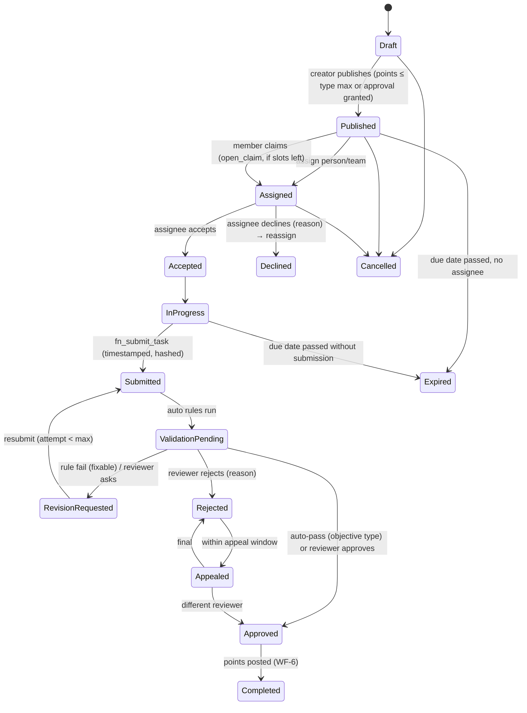

- Deadline extensions need `task.assign` in scope, and they log the original due date.
- Approved submissions are locked (`locked_at`). The member cannot alter them or their points.
- Team tasks: one submission per team by the lead or captain, then point allocation (WF-6).

## WF-5: Task validation (hybrid)

| Task type (examples) | Auto rules (objective gates) | Human review | Fraud prevention | Resubmission | Appeal | Points awarded when |
|---|---|---|---|---|---|---|
| **Form completion / survey** | Linked response exists (Forms/Sheet API or native form), required fields present, completed before deadline, unique per person | None (auto-approve) unless sampled | Response must carry the member's verified email. One per person | Not needed | — | Auto-pass |
| **Event attendance** | `checkins` row with `result='ok'` for the required session | None | QR single-use, scanner role time-boxed, photo/avatar shown at the door | — | Missing scan → manual attendance claim reviewed by EM | Auto-pass |
| **Data entry (N records)** | Record count ≥ N, schema valid, no duplicate rows (hash), spot-check sample of 5% | Spot-check by HR | Duplicate detection across members | Yes (max 2) | Yes | After spot-check |
| **File deliverable (poster, deck, video)** | File type/size, not a duplicate hash, not a perceptual near-duplicate of past submissions, deadline | **Required**: rubric (relevance, quality, brand compliance) | Near-duplicate image hash, reverse-check against the club's media library | Yes (max 3) | Yes | Reviewer approves (4-eyes above threshold) |
| **Written article / research** | Word-count range, link checks, deadline | **Required**: rubric (accuracy, originality, clarity). Optional AI *assist* hints such as a similarity score, never a decision | Similarity check against previous submissions | Yes | Yes | Reviewer approves |
| **Social engagement** | Link format is an official Page post URL, deadline, (if linked identity) API match found (WF-14) | Required when no API match: evidence screenshot reviewed | Screenshot hash duplicates, account linking, sampled audits | Yes (max 1) | Yes | API match **or** human-verified evidence |
| **Operational work** (venue booking, logistics, sponsor outreach) | Required fields and links | **Required**: lead confirms outcome | Lead ≠ assignee | Yes | Yes | Lead + HR (above threshold) |
| **Leadership contribution** | — | **Required**: panel (HR + SA or TA) | Panel members distinct, conflict declaration | — | Yes | Panel decision |
| **Creative / event execution** | Deadline | **Required**: EM + HR | — | — | Yes | Two-person approval |

Principles: automation can only **gate** (pass/fail/flag on objective facts). Any **quality** judgement is human. AI may **suggest** (e.g. "similar to submission #812"), but the suggestion is stored as a `validation_results` row of kind `flag` and never awards points.

## WF-6: Points award, adjustment, reversal

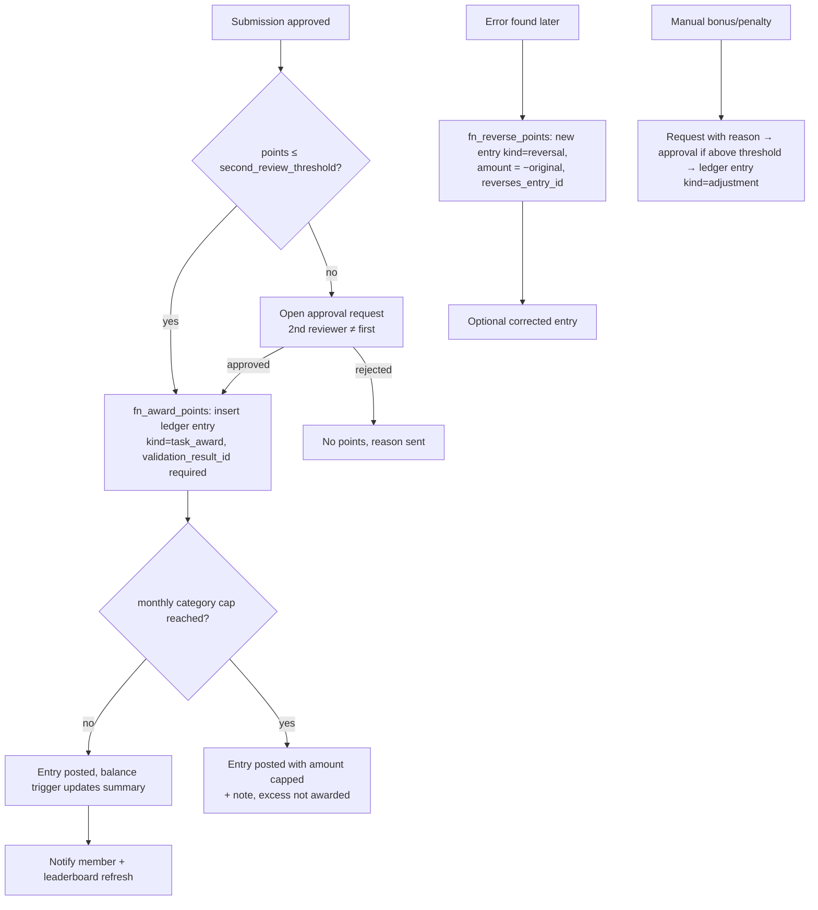

- The ledger is never updated or deleted. Each entry can be reversed at most once (UNIQUE on `reverses_entry_id`).
- Team allocation: the lead proposes a split. The sum must equal the award. If any share exceeds an equal share by more than 25%, HR approval is required.

## WF-7: Achievements and Monthly Best Member

**Achievements**
1. An authorised issuer (SA, HR, or EM for event contributions) creates an `achievement_records` row with evidence, which puts it in `pending_verification`.
2. A verifier distinct from the issuer verifies it, after which it becomes `active` and locked. Optionally a certificate is issued (WF-15).
3. The member sees it on their profile. They may request correction (WF-16) but cannot edit it.
4. Revocation: SA only, MFA, reason, audit. Linked certificates are revoked automatically.

**Monthly Best Member**

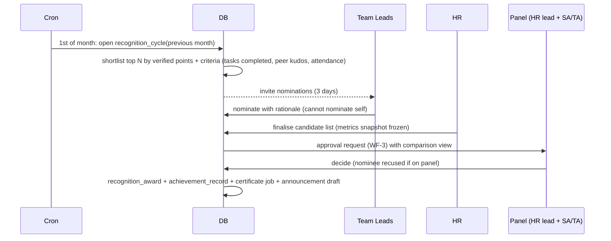

## WF-8: Event lifecycle

`draft → (pending_approval, if policy) → published → registration_open (time-based) → registration_closed → ongoing → completed → archived`, with `cancelled` reachable from any pre-completed state.

| Transition | Rule |
|---|---|
| draft → published | `event.publish`. Checks: banner has alt text, at least one ticket type, refund policy set if paid, venue set |
| → cancelled | `event.manage` + reason. Notify all registrants. Paid registrations → refund workflow (WF-12) bulk-created for approval |
| capacity change | `fn_set_capacity` cannot go below `sold_count`. An increase triggers waitlist promotion |
| completed | Generate the attendance summary, unlock certificate issuance (WF-15) and analytics snapshot |

## WF-9: Registration and seat reservation

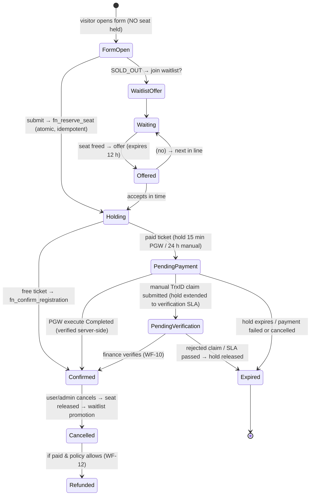

**How availability changes in each scenario the brief asked about:**

| Scenario | `held_count` | `sold_count` | Public "seats left" (= capacity − sold − held) | Broadcast |
|---|---|---|---|---|
| Visitor opens the form | unchanged | unchanged | unchanged | none |
| Reservation initiated (submit) | +units | — | decreases | yes |
| Payment succeeds (PGW execute = Completed, or manual verification) | −units | +units | unchanged (seat moves from held to sold) | yes (status may change) |
| Payment fails / cancelled at bKash / hold expires | −units | — | increases | yes |
| User cancels a confirmed seat | — | −units | increases → waitlist offer may immediately re-hold it | yes |
| Admin increases capacity | — | — | increases → waitlist promotion | yes |
| Admin decreases capacity | — | — | decreases (refused below `sold_count`; existing holds honoured) | yes |
| Event sells out | `capacity = sold + held` → status `sold_out` (or `almost_full` at ≥ 90%) | | 0 | yes |

**Concurrency protection:** the single conditional `UPDATE … WHERE sold+held+units ≤ capacity` takes a row lock, so concurrent attempts serialise on that row and the last seats cannot be double-sold. `UNIQUE(event_id, identity_key)` stops duplicate registrations. `idempotency_key` stops double-clicks and retries. Per-IP and per-identity rate limits (Vercel Firewall + DB function check: max 3 holds per identity per hour) prevent seat hoarding by bots, and Turnstile protects the public form.

**Real-time delivery:** an AFTER UPDATE trigger on `ticket_types` sends an aggregate broadcast to `event:{id}:availability` (Doc 3 §9). Clients receive it in under ~1–3 s, with a polling fallback.

## WF-10: Incoming payments

### 10a. Stage 1: manual bKash "Send Money" with a verified TrxID

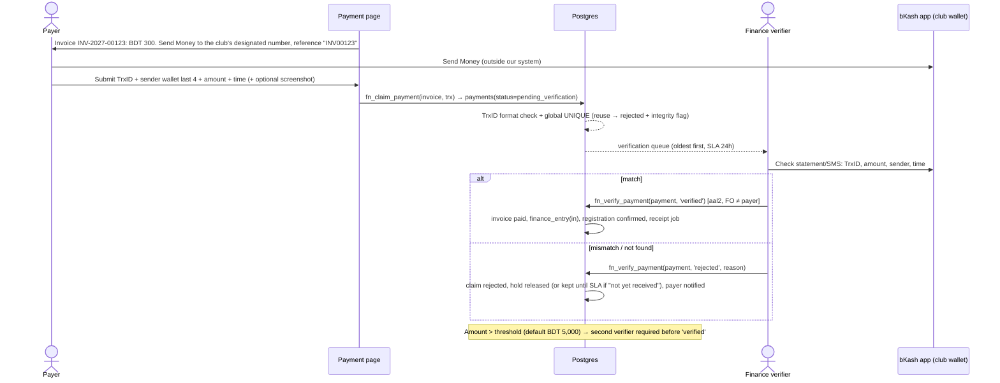

- **What the system never does:** mark a payment received because the payer typed a TrxID, store bKash PINs or OTPs, or accept a TrxID already used anywhere in the system.
- **Reference:** payers are asked to put the invoice short code in the bKash "Reference" field, which speeds up matching.
- **Reconciliation:** weekly, the custodian exports or photographs the wallet statement. The FO runs a reconciliation run (WF-11 §reconcile). Unmatched wallet credits become `reconciliation_required`.

### 10b. Stage 2: bKash Tokenized Checkout (after a merchant account exists)

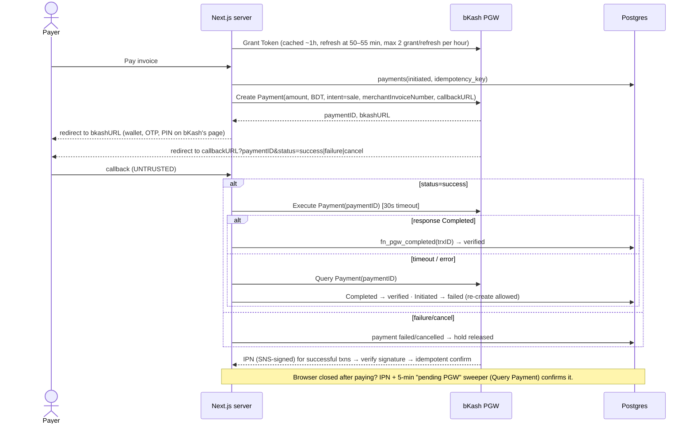

Documented bKash facts used here (developer.bka.sh, read 14 Nov 2026): token valid 3,600 s, refresh between minutes 50 and 55, no more than two grant/refresh calls per hour; 30 s timeout on all APIs; `paymentID` valid 24 h and executable once (a duplicate execute returns `2062 payment_already_completed`); if execute times out, call Query Payment; IPN is SNS-style (`SubscriptionConfirmation`, signed `Notification`) and covers successful transactions only.

### 10c. Teacher monthly dues

`dues.generate` (1st of each month) creates one invoice per teacher on an active dues plan (UNIQUE per period). The teacher dashboard shows an outstanding banner. Payment uses 10a or 10b. Reminders go out at most once a week, and arrears are visible only to the teacher, FO and SA.

## WF-11: Disbursements (maker-checker)

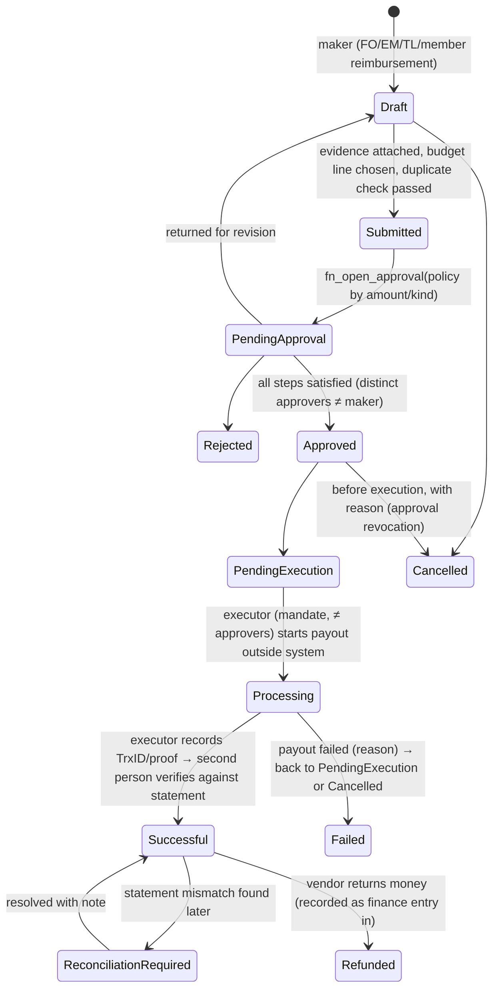

- **Duplicate prevention:** a soft block is shown when the same payee, amount (±1%) and purpose appear within 30 days. Override needs a reason. `UNIQUE(method, provider_trx_id)` applies to executions.
- **Approval revocation:** an approver can revoke their approval only before execution starts. After that, only the cancellation and refund paths apply.
- **"Approved" ≠ "Paid":** status `successful` requires a recorded execution reference plus verification by a person who was neither the executor nor (for amounts above the threshold) an approver.

## WF-12: Refunds

`requested → (approval per policy) → approved → processing → completed | failed → (retry) | rejected`

- The refundable amount is computed server-side: `payment.amount − sum(completed refunds)`.
- **Stage 1 (manual):** the FO sends money back via bKash, records the TrxID, and a second person verifies it.
- **Stage 2 (PGW):** call the Refund API. Per bKash docs, refunds are allowed **within 60 days**, up to **10 partial refunds** per transaction, and the same transaction cannot be refunded twice within 10 minutes. On timeout, call Refund Status before retrying.
- The event seat is released at **request** time for user-initiated cancellations and at **approval** time for admin-initiated ones (configurable).

## WF-13: Gmail ingestion (labelled subset)

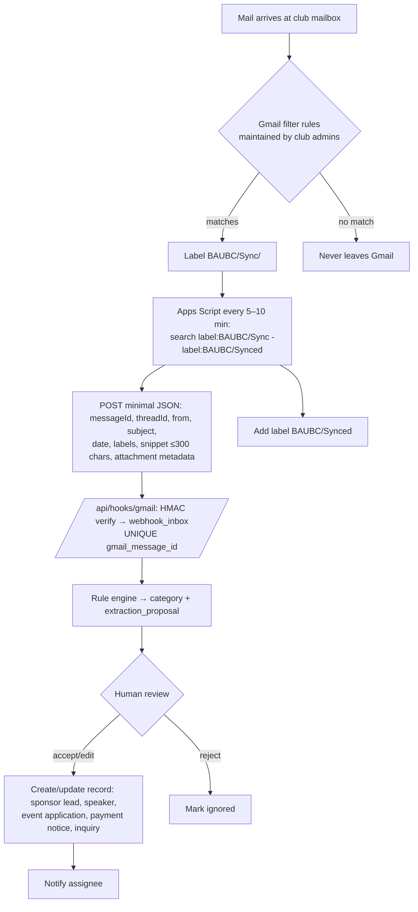

- Bodies and attachments are pulled **only** on demand by a reviewer (script endpoint with HMAC). Attachments are size-limited and type-allowlisted (PDF, images, DOCX), malware-scanned (ClamAV in the worker, or rejected if the scanner is unavailable), and stored privately.
- **Target architecture (P3):** Gmail API `users.watch` → Pub/Sub → push endpoint → `history.list` from the stored `historyId`. Renew the watch **daily** (it must be renewed at least every 7 days). On HTTP 404 for an expired `historyId`, do a full sync. Push can be delayed or dropped, so a periodic `history.list` sweep is mandatory. This requires an **Internal** OAuth app in a Google Cloud project owned by the bau.edu.bd organisation (Doc 7 §1).

## WF-14: Facebook engagement validation

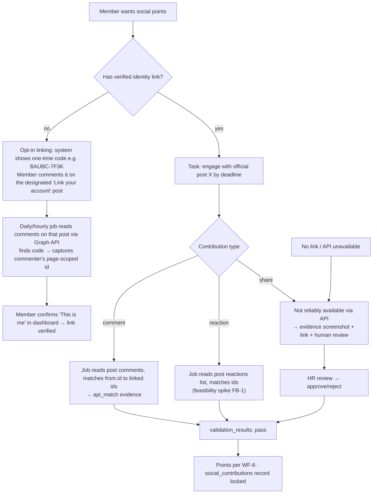

- **Never** award points on the assumption that someone engaged. Each award needs either an API match tied to a verified link or human-verified evidence.
- Page-scoped IDs are unique per user-Page pair. A member's profile URL cannot be converted to this ID, which is why the comment-code link exists.
- Reading other users' comments and reactions may need **Advanced Access** for `pages_read_user_content` / `pages_read_engagement` (App Review + Business Verification) unless the account linking and reads work under Standard Access for the Page's own admins. **Spike FB-1 decides this**. Until then, social tasks run on evidence + human review only.

## WF-15: Certificate and document generation

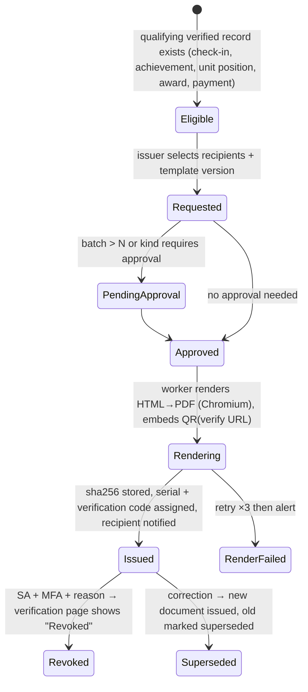

- **Data snapshot:** the name, event and role are copied into `data_snapshot` at issue time, so later profile changes never alter an issued certificate. Corrections reissue a new document.
- **Verification page** `/verify/{code}` shows the serial, kind, recipient display name, title or event, issue date, issuing authority and status. It never shows email, phone or student ID. Rate limit: 10/min per IP.
- **CV (annual):** the member opens "Generate my 2026–27 CV". The system assembles **verified** sections (positions, achievements, events, tasks, points summary, certificates). The member chooses which approved personal fields to include and orders the sections. Self-declared skills are labelled. The snapshot is stored and the PDF rendered.

## WF-16: Profile correction requests

`requested → under_review → approved (applied via fn_apply_profile_change, old/new logged) | rejected (reason) | info_requested`

- Legal-name corrections need evidence (e.g. a university ID card image, which is deleted after decision + 30 days).
- Approved corrections to names trigger an optional "reissue affected certificates" prompt.

## WF-17: Check-in

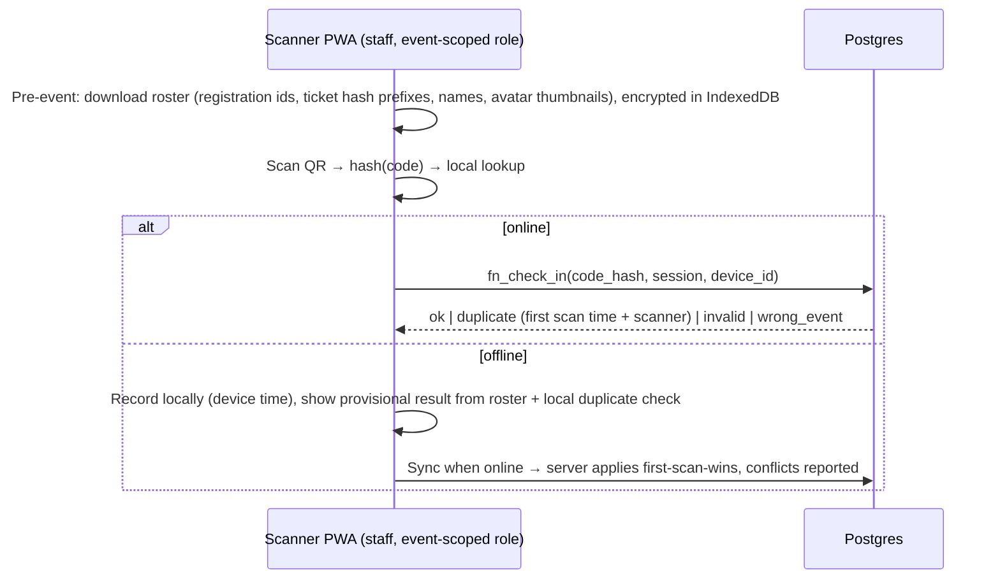

- The ticket QR contains only an opaque random code (no PII). Sharing a screenshot is mitigated by showing the name and photo/avatar on the scanner, single use per session, and an optional rotating QR in the member app.
- Scanner permissions are valid only from event start − 3 h to end + 3 h.

## WF-18: Perk claim

`browse (eligible only) → claim (fn_claim_perk: eligibility check, UNIQUE per member, allocate code FOR UPDATE SKIP LOCKED) → reveal (logged) → (optional) partner redemption report`. A leaked code is revoked: mark it `revoked`, issue a new code to the rightful claimant, and flag the incident.

## WF-19: Privacy (data subject) requests

`received → identity verified → in progress → fulfilled | partially fulfilled (legal hold: finance and audit records) | rejected (reason)`, with a due date tracked. Access requests export the person's data as JSON + PDF summary. Erasure anonymises personal fields but keeps legally required financial and audit records linked to a pseudonymous ID.
