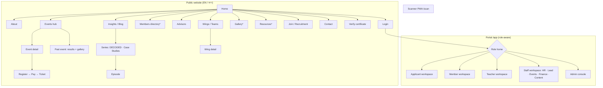

# Document 6: UI/UX Design Brief

> **Creative thesis: "Field & Signal".** BAUBC sits where **agriculture** (patient growth, land, seasons) meets **business and technology** (signals, markets, speed). The visual system turns that intersection into one idea: **furrow lines that become market lines**. Ploughed-field contours are the same visual shape as a rising chart. Every surface is built from that idea. Calm "field paper" surfaces are for reading and working. Deep "canopy" surfaces are for cinematic moments. A single **bio-lime signal** colour marks what is live, actionable or verified.
>
> A live specimen of this direction (palette, type, components and motion) is in [`design-direction.html`](design-direction.html). Open it in a browser.

## 1. Design goals

1. **Distinctive, not decorative.** The site should be recognisable in a single frame with the logo hidden. The test: a screenshot of any page (public or dashboard) must be identifiable as BAUBC.
2. **One product, many rooms.** The public site, member portal, teacher portal and admin console share the same tokens, type and motion grammar. Only density changes.
3. **Bangla is first-class.** Every layout is designed with Bangla strings, which are 10–25% taller and often longer. English is not the master layout.
4. **Fast on a ৳10,000 Android over 4G.** Motion and imagery never cost the reader their data budget.
5. **Trust through clarity.** Official, locked or verified records look visibly different from editable ones (the "Ledger Stamp"). Money screens are calm and explicit.

## 2. Creative directions explored

| Direction | Idea | Strengths | Weaknesses | Verdict |
|---|---|---|---|---|
| A. **Agronomic Editorial** | Off-white paper, botanical plates, seed-catalogue labels, serif-led editorial layout | Academic credibility, timeless, prints well (certificates, CVs) | Can feel slow and "old university" to an 18–24 audience. Weak for live data | Partially adopted (labels, paper, certificates) |
| B. **Bio-Lime Terminal** | Dark canopy canvas, lime signals, trading-terminal tickers, monospaced data | Energetic, startup-native, great for DECODED and the Summit | Fatiguing for long reading. Dark-only dashboards reduce legibility outdoors on phones | Partially adopted (cinematic sections, signal colour, data type) |
| C. **Growth Systems** | Generative growth rings, cellular field plots, data-driven organic shapes | Unique and meaningful for points and progress | Risk of becoming an abstract art project. Heavy to compute | Adopted as **signature components only** |
| **★ Field & Signal (recommended)** | A + B + C as one system: paper for reading and work, canopy for moments, lime only as signal, growth motifs for data | Distinctive, coherent from website to certificate, scalable to dashboards | Requires discipline (lime overuse kills it) | **Recommended** |

## 3. Signature components (what makes it BAUBC)

| Component | Description | Used in |
|---|---|---|
| **Furrow Field** | Generative SVG of parallel contour lines (ploughed land). On scroll, the lines bend upward into a market curve: *from field to market*. Static fallback for reduced motion | Home hero, Summit page, 404 |
| **Specimen Label** | Seed-packet style tag: hairline border, mono uppercase metadata, index number (`EP 04 · MONPURA · 2009`) | Categories, episode numbers, member IDs, certificate serials |
| **Seat Plot** | Event capacity drawn as a grid of field plots. Filled = taken, hatched = on hold, outline = available. Changed plots "sprout" in real time | Event page, registration, organiser dashboard |
| **Growth Rings** | A member's contribution over the years as tree rings. Ring = year, thickness = verified points, segments = categories | Member profile, annual CV cover, Best Member feature |
| **Ledger Stamp** | Circular "VERIFIED · BAUBC · 2026" stamp with a lock glyph on official records, which also signals "not editable by you" | Achievements, points entries, certificates, finance records |
| **Harvest Ticker** | Slow horizontal ticker of live club signals (next deadline, seats left, newest episode). Pauses on hover. Static list for reduced motion | Home, member home |
| **Term Sheet card** | Event and sponsorship details formatted like a term sheet (fee, seats, deadline, eligibility) | Event cards, sponsor page |
| **Decision Card** | Calm, full-context approval card with a sticky decision bar and mandatory note fields | Teacher Approver and admin approvals |

## 4. Page map


`*` = optional page, toggled by an admin.

## 5. Key user journeys

| # | Journey | Steps | Moments that matter | Design response |
|---|---|---|---|---|
| J1 | **Student → applicant → member** | Sees a recruitment post on Facebook → `/join` → Google Form → activation email → sets password → applicant workspace → info request → provisional → finalised → member workspace | The silence after applying. Fear of rejection | A **growth-stage tracker** (seed → sprout → sapling → tree) with honest timelines ("Reviews close 12 Dec"). Respectful rejection copy with the next cycle date |
| J2 | **Public visitor → Summit attendee** | Event page → sees live seats → registers (team) → pays via bKash → ticket with QR → reminder → check-in → certificate | Anxiety about whether payment "went through". Losing a seat while paying | A visible hold timer ("Seat held for 14:32"). A clear manual-payment instruction card. Status page reachable by magic link. No ambiguous states |
| J3 | **Teacher Approver decides a disbursement** | Email/push → Decision Card → views evidence → approves with a note (MFA) | Lack of context. Fear of approving something wrong | All context on one card: purpose, amount, budget remaining, evidence thumbnails, requester history, policy rule. A sticky decision bar. "Request clarification" is as prominent as Approve |
| J4 | **HR reviewer clears the queue** | Review queue → submission side by side with rubric → approve/revise/reject → next | Fatigue. Inconsistency | Keyboard-first review (`A`/`R`/`V`/`→`). Rubric pinned. Auto-rule results shown as chips. Integrity flags in amber |
| J5 | **Finance Officer verifies bKash claims** | Verification queue → compare TrxID/amount/time to wallet statement → verify or reject | Typos. Duplicates. Pressure during peak | Large mono TrxID with copy button. Matching hints (same amount & time window). Duplicate TrxID blocked at entry. Batch view sorted by claim time |
| J6 | **Member builds annual CV** | Member home → "My 2026–27 record" → choose fields → generate PDF | Wanting to edit locked items | Locked items carry the Ledger Stamp and a "Request correction" link. Self-declared skills are labelled honestly |
| J7 | **Volunteer scans at the door** | Opens `/scan` → downloads roster → scans → green/amber/red full-screen result | Bad network. Crowds | Offline roster. Huge colour-coded results with haptic feedback. Manual search fallback |

## 6. Low-fidelity wireframes (structure before visuals)

### 6.1 Home (mobile first; desktop expands to 12 columns)

```
┌──────────────────────────────┐
│ ▣ BAUBC          EN/বা   ☰  │  header (72px → 56px on scroll)
├──────────────────────────────┤
│ [Furrow Field background]    │  HERO (canopy)
│ GROW FOUNDERS                │  display, 2 lines
│ FROM THE FIELD.              │
│ মাঠ থেকে বাজারে।               │  Bangla line, Anek Bangla
│ [Join BAUBC] [Next event →]  │  primary (lime fill) + ghost
│ ─ Harvest Ticker ─────────── │  "SUMMIT · 38 seats left · closes 5 Jan"
├──────────────────────────────┤
│ WHAT WE DO (3 pillars)       │  Agriculture · Technology · Strategy
├──────────────────────────────┤
│ NEXT UP: Startup Summit 2027 │  Term Sheet card + Seat Plot mini
├──────────────────────────────┤
│ DECODED  ▸ episode rail      │  cinematic dark band, horizontal scroll
├──────────────────────────────┤
│ IMPACT IN NUMBERS            │  counters (verified aggregates)
├──────────────────────────────┤
│ WINGS · ADVISORS · PARTNERS  │
├──────────────────────────────┤
│ JOIN CTA (cycle status)      │
│ footer: contact, socials,    │
│ verify certificate, privacy  │
└──────────────────────────────┘
```

### 6.2 Event detail and registration

```
Desktop: 8 / 4 split                                   Mobile: stacked; sticky bottom CTA
┌───────────────────────────────┬────────────────────┐ ┌───────────────────────┐
│ Specimen label: SUMMIT · 2027  │ TERM SHEET (sticky)│ │ hero image            │
│ Title / subtitle               │ Fee      ৳300      │ │ title                 │
│ Date · Venue · map link        │ Seats    38 / 400  │ │ Seats left 38 ▮▮▮▯    │
│ About (rich blocks)            │ [Seat Plot grid]   │ │ ...content...         │
│ Agenda (sessions)              │ Deadline 5 Jan     │ │                       │
│ Speakers / Judges grid         │ Eligibility        │ ├───────────────────────┤
│ Partners                       │ [Register →]       │ │ [Register · ৳300]  ▲  │
│ FAQ                            │ waitlist note      │ └───────────────────────┘
└───────────────────────────────┴────────────────────┘
Registration: 1 Details → 2 Team (if team ticket) → 3 Review (hold starts here) → 4 Pay → 5 Ticket
Hold timer is visible from step 3. Manual-payment card: number, amount, reference, TrxID form.
```

### 6.3 Member workspace (home)

```
┌ rail ┐┌──────────────────────────────────────────────────────┐
│ Home ││ Good evening, Nusrat ·  Member BAUBC-2026-0142  🔒    │
│ Tasks││ ┌Due soon (3)──────┐ ┌Points this month─┐ ┌Next event─┐│
│ Event││ │ • Poster for …   │ │  120 ▲  rank #8  │ │ Summit …  ││
│ Point││ └──────────────────┘ └──────────────────┘ └───────────┘│
│ Recor││ Growth Rings (year view) │ Recent verified entries (ledger)│
│ Perks││ Announcements            │ Certificates & CV               │
└──────┘└──────────────────────────────────────────────────────┘
Mobile: bottom nav [Home · Tasks · Events · Record · More]
```

### 6.4 Teacher Approver: Decision Card

```
┌───────────────────────────────────────────────────────────────┐
│ DISBURSEMENT · DR-2027-0031 · step 1 of 2 · due in 2 days      │
│ ৳18,500  Venue deposit, Startup Summit 2027                   │
│ Payee: <venue org> · bKash ••••4471 · budget line Summit/Venue │
│ Budget: ৳60,000 allocated · ৳22,000 used · this: 31%           │
│ Evidence: [quote.pdf] [invoice.jpg]  (open in viewer)          │
│ Requested by: Finance Officer (Rafi) · 14 Dec · 3 prior requests│
│ Policy: 2,001–20,000 → TA + (TA or SA), distinct people        │
│ Similar past requests: none in 30 days                         │
├───────────────────────────────────────────────────────────────┤
│ Note (required for reject/return) [______________________]     │
│ [Request clarification]  [Return]  [Reject]   [Approve ▸ MFA]  │ sticky
└───────────────────────────────────────────────────────────────┘
```

### 6.5 Admin: membership review

Split view. The left pane is a filterable table (status, department, session, wing preference, duplicate flag, age in queue), with a checkbox column for bulk actions. The right pane is the selected application: answers, photo/avatar (blurred until clicked, to reduce bias in early screening, optional), reviewer scores, history timeline and an action bar with transition buttons (only legal transitions render). Bulk actions open a confirmation modal that requires typing the number of records.

### 6.6 Finance: payment verification queue

The table columns are Claim time · Invoice · Payer (masked) · Amount · **TrxID (mono, copy)** · Sender last 4 · Age · Hints (e.g. "amount matches 2 statement lines"). The row expands to show the screenshot (if any) and Verify/Reject buttons, with a reason picker on reject. A threshold badge "2nd verifier needed" shows when it applies.

### 6.7 Scanner

A full-screen camera with a bottom sheet showing a result card (name, avatar, ticket type, session). Result colours: **green** OK · **amber** already checked in (with first scan time) · **red** invalid or wrong event. Haptic and sound cues. An offline badge plus a queued-sync count.

## 7. Design system

### 7.1 Colour tokens

| Token | Hex | Role |
|---|---|---|
| `canopy-950` | `#07140E` | Deepest background (cinematic sections, dark mode base) |
| `canopy-900` | `#0B2117` | Dark surfaces, cards on dark |
| `forest-800` | `#0F3A27` | Deep green, primary brand on light, nav backgrounds |
| `forest-700` | `#155234` | Primary text-on-light accent, links on paper-100 |
| `emerald-600` | `#0B7A4B` | Interactive green on paper-50 / white, success |
| `emerald-500` | `#14A062` | Large text, icons and borders only on light (3.08:1) |
| `leaf-400` | `#52C48A` | Green on dark, chart series |
| `biolime-400` | `#C8F53C` | **Signal**: primary CTA fill, live indicators, focus halo |
| `biolime-300` | `#DBFF73` | Signal on dark text, highlights |
| `lime-100` | `#F1FFC9` | Tint: success or updated-row flash on light |
| `paper-50` | `#F6F5EE` | Default light background ("field paper") |
| `paper-100` | `#ECEADF` | Raised/sunken light surfaces, table stripes |
| `stone-400` | `#A8A493` | Muted text on dark, dividers |
| `stone-600` | `#6B6A5C` | Muted text on light |
| `ink-800` | `#262A22` | Secondary text |
| `ink-900` | `#151913` | Primary text |
| `harvest-500` | `#E9A23B` | **Warm accent**: awards, DECODED, warnings (fill) |
| `harvest-700` | `#9A5B0E` | Warning text on light |
| `soil-600` | `#C2412D` | Danger / destructive / rejected |
| `river-600` | `#2560C8` | Info / under review / neutral links in dashboards |

**Measured contrast (WCAG 2.x), computed for this brief:**

| Pair | Ratio | Allowed use |
|---|---|---|
| ink-900 on paper-50 | 16.28 | All text |
| stone-600 on paper-50 | 5.00 | Body and muted text |
| forest-700 on paper-50 | 8.40 | Links, headings |
| emerald-600 on paper-50 | 4.93 | Text OK (not on paper-100: 4.46 ✗) |
| emerald-500 on paper-50 | 3.08 | Large text, icons and UI borders only |
| **biolime-400 on paper-50** | **1.16** | **Never as text or meaningful icon on light** |
| paper-50 on canopy-950 | 17.23 | All text |
| biolime-400 on canopy-950 | 14.87 | Text, icons, focus |
| leaf-400 on canopy-950 | 8.63 | Text |
| stone-400 on canopy-950 | 7.53 | Muted text on dark |
| canopy-950 on biolime-400 | 14.87 | **CTA label on lime button** |
| forest-800 on biolime-400 | 10.02 | Text on lime |
| harvest-700 on paper-50 | 4.96 | Warning text |
| soil-600 on paper-50 | 4.70 | Error text |
| white on soil-600 | 5.14 | Destructive button label |
| river-600 on paper-50 | 5.36 | Info text |
| ink-900 on harvest-500 | 8.21 | Text on amber chips |

**Themes:** **Field** (light, default for the portal and reading pages) and **Canopy** (dark: cinematic public sections, optional dark mode in the portal, following `prefers-color-scheme` with a user toggle). Status colours keep their meaning across themes.

**Lime discipline:** at most **one** lime-filled element per viewport (the primary action or the live signal). Lime is never used for decoration.

**Status chips:** Draft (stone) · Pending / Pending verification (harvest tint, harvest-700 text) · Under review (river tint) · Approved / Verified / Confirmed (emerald tint, forest text) · Rejected / Failed (soil tint) · Locked / Official (forest-800 fill, paper text, lock glyph) · Live / Open (lime dot + label).

### 7.2 Typography

**Families (all SIL Open Font License 1.1, on Google Fonts, axes checked 14 Nov 2026):**

| Role | Family | Axes used | Why |
|---|---|---|---|
| Display (Latin) | **Bricolage Grotesque** | `opsz 12–96`, `wdth 75–100`, `wght 200–800` | Characterful grotesque with optical sizes. Condensed widths give poster-like headlines, and it does not look like a default template |
| Editorial accent (Latin) | **Instrument Serif** (regular + italic) | — | Cinematic italic for DECODED titles and pull quotes. Used sparingly |
| Body and UI (Latin) | **Geist** | `wght 100–900` | Neutral and highly legible at small sizes, with tabular figures for dashboards |
| Data and codes | **Geist Mono** | `wght 100–900` | TrxIDs, serials, member IDs, specimen labels |
| Bangla display and headings | **Anek Bangla** | `wdth 75–125`, `wght 100–800` | Its variable width axis lets Bangla headlines match condensed Latin display widths. Contemporary letterforms by Ek Type |
| Bangla body and UI | **Noto Sans Bengali** | `wdth 62.5–100`, `wght 100–900` | Robust conjunct coverage and very readable at 15–18 px. Pairs neutrally with Geist |
| Bangla editorial (optional) | **Tiro Bangla** (regular + italic) | — | Literary voice for Bangla pull quotes and long-form essays |

Considered and rejected: Hind Siliguri (static weights and very common, so the site would look generic), Baloo Da 2 (too playful for a business club), Galada (decorative script, hero art only), commercial Bangla faces (licensing cost).

**Loading:** self-host through `next/font/google`, so no runtime requests go to Google (good for privacy and speed). Google's `unicode-range` splitting means Bengali files download only when Bengali glyphs appear. Preload only the display and body faces for the active locale. `font-display: swap` with metric-matched fallbacks (`size-adjust`) keeps CLS near zero. Fallback stacks: Latin `system-ui, "Segoe UI", Roboto, sans-serif`; Bangla `"Noto Sans Bengali", "Nirmala UI", "Vrinda", sans-serif`.

**Weight scale:** 300 (display, very large only) · 400 body · 500 UI labels · 600 headings and buttons · 700 display emphasis · 800 hero only. Bangla never goes below 300.

**Type scale (fluid; rem = 16 px):**

| Token | Latin size / line-height / tracking | Bangla adjustments |
|---|---|---|
| `display-2xl` | `clamp(3.5rem, 2rem + 7vw, 9rem)` / 0.92 / −0.035em, opsz 96, wdth 80 | line-height 1.15, tracking 0, Anek wdth 85 |
| `display-xl` | `clamp(2.75rem, 1.6rem + 5vw, 6rem)` / 0.95 / −0.03em | lh 1.18 |
| `h1` | `clamp(2.25rem, 1.6rem + 2.8vw, 3.75rem)` / 1.05 / −0.02em | lh 1.25 |
| `h2` | `clamp(1.75rem, 1.35rem + 1.8vw, 2.75rem)` / 1.1 / −0.015em | lh 1.3 |
| `h3` | `1.5rem` / 1.2 / −0.01em | lh 1.4 |
| `h4` | `1.25rem` / 1.3 / 0 | lh 1.45 |
| `body-lg` (reading) | `1.125rem` / 1.6 | **1.06× size**, lh 1.8 |
| `body` (UI) | `1rem` / 1.55 | 1.06× size, lh 1.75 |
| `small` | `0.875rem` / 1.45 | lh 1.65 |
| `label` (specimen) | `0.75rem` mono / 1.3 / +0.08em uppercase | Bangla: no uppercase transform, weight 600, tracking 0 |
| `data-xl` (KPI) | `2.5rem` Geist tabular / 1.0 | Bangla numerals optional via `Intl.NumberFormat('bn-BD')` |

**Bangla rules (non-negotiable):** never apply negative letter-spacing; `font-synthesis: none` (no fake italics); no `text-transform`; minimum 16 px for body; avoid weights < 300; allow 10–20% extra line length; always set `lang="bn"` on Bangla runs so the correct font, line-height and hyphenation (off) apply via `:lang(bn)`. Check conjunct rendering (e.g. ক্ষ, জ্ঞ, ন্ত্র, স্ক্র) in every heading weight before release.

**Reading measure:** 60–72 characters for Latin and 50–65 for Bangla. Max article width: 42 rem.

### 7.3 Space, grid, radius, elevation, borders

| Token group | Values |
|---|---|
| Spacing (4 px base) | 0, 4, 8, 12, 16, 20, 24, 32, 40, 48, 64, 80, 96, 128. Public section rhythm `clamp(64px, 10vw, 160px)` |
| Grid | 4 columns (< 640 px, 16 px gutters, **16 px side margin**) · 8 columns (640–1024, 24 px) · 12 columns (≥ 1024, 32 px). Content max 1360 px. Full-bleed media allowed |
| Dashboard density | Comfortable (default) / Compact (tables: 36 px rows) |
| Radius | 2 (data cells) · 6 (inputs, chips) · 10 (buttons, cards) · 20 (feature panels, sheets) · full (pills, avatars) |
| Elevation | Tonal layering first (paper-50 → white → paper-100). Shadows only for overlays: `0 24px 48px -12px rgb(7 20 14 / .25), 0 2px 6px rgb(7 20 14 / .08)` |
| Borders | Hairline 1 px `ink-900 @ 12%` (light) / `paper-50 @ 12%` (dark). Strong 1.5 px for active |
| Focus | 2 px `forest-700` ring + 4 px `biolime-400 @ 60%` halo (light) · 2 px `biolime-400` + 2 px offset (dark). Always visible on keyboard focus |

### 7.4 Components (behaviour contracts)

| Component | Variants | Rules |
|---|---|---|
| **Button** | Primary (lime fill, canopy label) · Secondary (forest outline) · Ghost · Destructive (soil) · Icon | Minimum 44×44 px target. Loading state keeps width and shows a seed loader. Destructive actions need a confirm step. Press scale 0.98 |
| **Input / Select / Textarea** | Default · error · disabled · read-only-verified (Ledger Stamp + lock) | Label always visible (no placeholder-as-label). Errors inline + summary at the top for long forms. Bangla input supported (no `pattern` that blocks Unicode) |
| **Table** | Data table (sort, filter, column chooser, bulk select, sticky header), mobile cards | Server pagination. Empty, loading (skeleton rows) and error (retry) states. Row update flashes lime-100 |
| **Card** | Content, Term Sheet, KPI, Decision, Specimen | Never more than 3 nested levels. Cards in dashboards are surfaces, not floating tiles |
| **Modal / Sheet** | Dialog (desktop) → bottom sheet (mobile) | Focus trapped. `Esc` closes non-destructive dialogs. Destructive dialogs need typed confirmation for bulk actions |
| **Toast / Notification** | Info · success · warning · error | Polite live region. Auto-dismiss 5 s (not for errors). Pause on hover |
| **Status chip** | See §7.1 | Text + colour (never colour alone), plus an icon for verified/locked |
| **Stepper** | Growth stages (application) · numbered (registration) | Shows a time estimate per stage |
| **Empty state** | Illustration (line-art furrow) + 1 sentence + 1 action | Explains *why* it is empty and what happens next |
| **Error state** | Inline · page · offline | Plain-language cause, what was saved, retry, and an incident reference ID |
| **Loading** | Skeletons (layout-matched) · inline spinners < 1 s avoided · progress bar for uploads | No spinner-only pages. Skeleton shimmer disabled for reduced motion |
| **Avatar** | Photo · **character avatar** · initials | Members who do not want to show their face pick a character avatar (built-in avatar maker in P2: skin tone, hair/hijab/cap, glasses, attire colour) or upload their own illustration |

### 7.5 Imagery and illustration

- **Photography:** documentary, real club moments. Hero and DECODED imagery uses a **duotone** (canopy shadows, lime or paper highlights) with fine grain. Event galleries keep natural colour.
- **DECODED identity:** letterboxed 2.39:1 frames, Instrument Serif italic titles, Geist Mono metadata strip (`EP 04 · MONPURA · 2009 · MARKET DOWNTURN`), harvest-500 accents.
- **Illustration:** single-weight line art derived from furrow contours (empty states, avatars, 404). No stock 3D blobs.
- **Data visualisation:** charts use forest/emerald/leaf/harvest/river series (validated for colour-vision deficiency). Lime is reserved for "you" or "live".

## 8. Motion and interaction

**Principles:** motion explains *change* (something was added, moved or verified), never decorates idle content. Use transform and opacity only. Everything is interruptible, and everything has a reduced-motion equivalent.

| Token | Value |
|---|---|
| `dur-instant` | 90 ms (press, toggle) |
| `dur-fast` | 160 ms (hover, chip) |
| `dur-base` | 240 ms (menus, toasts, sprouting plots) |
| `dur-slow` | 420 ms (panels, chart growth) |
| `dur-scenic` | 900 ms (hero, section reveals) |
| `ease-furrow` | `cubic-bezier(0.16, 1, 0.3, 1)` (expo-out, the house curve) |
| `ease-soft` | `cubic-bezier(0.65, 0, 0.35, 1)` |
| Spring (Motion) | `{ stiffness: 380, damping: 32 }` for layout changes |

| Interaction | Behaviour | Reduced motion |
|---|---|---|
| Hero Furrow Field | Lines drift slowly. GSAP ScrollTrigger scrubs them into a market curve over the first viewport | Static SVG |
| Section reveal | Lines of text rise 12 px + fade, 40 ms stagger, once at 20% visibility | Instant |
| Page transitions | View Transitions API: cross-fade + shared element (event card image → event hero) where supported | Cross-fade 0 ms |
| Navigation | Header condenses on scroll. Menu opens as a canopy sheet with staggered links | No stagger |
| Buttons | Press 0.98, furrow-wipe hover fill (left → right, 240 ms) | Colour change only |
| Seat Plot | Changed plot "sprouts" (scale 0.6 → 1, 240 ms). Counter ticks. ≤ 10% left: a slow 2 s lime pulse ring on the badge | Number updates, no pulse |
| Hold timer | Smooth countdown ring. At < 2 min it turns harvest | Text countdown |
| KPI counters | Roll up once when visible (tabular digits) | Final number |
| Charts | Bars and lines grow from the baseline in 420 ms. Updates morph | Instant |
| Table updates | Row flash lime-100 → transparent over 1.2 s | Static highlight icon |
| Approval decided | Ledger Stamp "stamps" (scale 1.15 → 1 + 2° rotate, 240 ms) | Fade in |
| Toasts | Slide up 8 px + fade | Fade |
| Dashboard load | Skeletons → content cross-fade 160 ms | No shimmer |

**Performance rules:** GSAP and Lenis load only on public routes that use them (dynamic import). Lenis only on fine-pointer devices with `deviceMemory ≥ 4` and no reduced-motion. Motion JS budget on public pages ≤ 45 KB gzipped. No animation runs while the page is hidden. `Save-Data` disables ambient motion and video.

## 9. Dashboard designs by role (Phase 17)

**Shared shell:** left rail (desktop) / bottom nav (mobile), a top bar with a **command palette (⌘K / Ctrl+K)**, notifications, a role switcher (for people with several roles, e.g. a member who is also a Team Lead) and a profile menu. The **"Needs you"** stack is always first on a role's home.

| Dashboard | Navigation (only what the role can use) | Home layout | Key tables and status indicators | Empty / loading | Mobile |
|---|---|---|---|---|---|
| **Super Admin** | Overview · Approvals · People (Applications, Members, Teachers) · Org · HR (Tasks, Points, Achievements, Recognition) · Events (Events, Registrations, Check-in, Competitions) · Finance (Verification, Payments, Disbursements, Refunds, Reconciliation, Budgets, Dues) · Integrations (Forms, Gmail, Facebook, Email) · Website (Pages, Insights, Gallery, Media, Navigation, Announcements) · Documents (Templates, Issued) · Perks · Reports · Audit · Settings (Roles, Policies, Features, Retention, System Health) | "Needs you" (counts + oldest age per queue) · KPI row (active members, pending applications, seats sold this week, unverified payments, integration health) · activity feed · upcoming 14 days | Every queue table shows age-in-queue, SLA colour (green < 50%, harvest < 100%, soil > SLA) | Empty: "All clear: no decisions waiting" + last cleared time | Approvals and verification are fully usable on mobile. Settings are desktop-first |
| **Teacher** | Home · Notices · Events · Documents · Dues · Profile | Notices (pinned first) · upcoming events · documents assigned · dues banner (if outstanding) | Read-only lists | "No new notices since your last visit" | Single column |
| **Teacher Approver** | + Decisions · History | Decision Cards stack sorted by due date. Counts per category | Approved/rejected history with a downloadable log | "Nothing to decide right now" | Decision Card adapts to full-screen with a sticky action bar |
| **HR** | Home · Review queue · Tasks · Members · Teams · Points · Achievements · Recognition · Reports | Queue size, oldest item, my reviews today, flags | Review queue (keyboard-first), integrity flags (amber) | Skeleton rows | Review on mobile is possible but desktop-optimised |
| **Team Lead** | Team · Tasks · Reviews · Performance | Team progress rings, overdue tasks, team points this month vs last | Team member list with task status | "Create your team's first task" | Full |
| **Finance Officer** | Verification · Payments · Disbursements · Refunds · Reconciliation · Budgets · Dues · Reports | Pending verifications (age), executions awaiting proof, reconciliation gaps | Mono TrxIDs, masked payers, amount alignment right | — | Verification queue optimised for mobile |
| **Event Manager** | Events · Registrations · Seats · Check-in · Competitions · Certificates | Live Seat Plot, registrations sparkline, pending payments, waitlist | Registration table with status chips | "Publish your first event" | Check-in via /scan |
| **Content Editor** | Pages · Insights · Series · Gallery · Media · Navigation · Announcements | Drafts, scheduled posts, missing alt text warnings | Media grid with alt-text badges | — | Desktop-first |
| **Member** | Home · Tasks · Events · My Record (points, achievements, certificates, CV) · Perks · Profile | Due soon, points this month and rank (if enabled), next event, announcements, Growth Rings | Ledger list with Ledger Stamps | "No tasks yet: your lead will assign the first one" | Bottom nav: Home · Tasks · Events · Record · More |
| **Applicant** | Application · Messages · Announcements · Profile | Growth-stage tracker, required actions (info requests with due date), timeline | Application history | "We're reviewing: expected decision by …" | Single column |

## 10. Accessibility (WCAG 2.2 AA)

- Contrast pairs are pre-validated (§7.1). Lime is never used as a text colour on light surfaces.
- Full keyboard paths, visible focus, skip links, logical heading order in both languages, `lang` on mixed-language runs.
- Targets ≥ 44 px. Drag-free alternatives (no drag-only interactions, per WCAG 2.2 SC 2.5.7). Accessible authentication: allow paste into password and OTP fields, and support password managers (SC 3.3.8).
- Live regions announce seat count changes politely (at most once per 10 s), not on every tick.
- Forms: errors are associated with inputs, and a summary appears at the top for long forms. Time limits (seat holds) are announced, and the user can request an extension once (SC 2.2.1).
- Charts include text summaries and data tables.

## 11. Content voice

- **English:** confident, concise and warm. Use "you" and "we". Verbs on buttons ("Register", "Verify payment").
- **Bangla:** natural standard Bangla (not machine-literal). Written by a native editor, not auto-translated, for all public copy.
- Rejections and errors: respectful and specific, always with a next step.
- Numbers: `৳` with thin space (`৳ 300`). Dates as `14 Dec 2026` or `১৪ ডিসেম্বর ২০২৬` depending on locale, always in Asia/Dhaka time.
