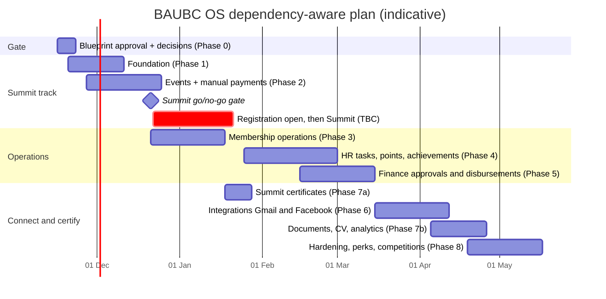

# Document 9: Implementation Roadmap

> **Planning assumptions.** Blueprint approval during the week of 16 Nov 2026. A core team of **2 developers** (one full-stack lead, one frontend/design engineer) at **~30 h/week each**, plus a part-time designer/content editor and a club "product owner" from the executive committee. Effort is in **developer-weeks (dw, 40 h)**. Cost notes refer to [Document 11](11-cost-infrastructure.md).
>
> **The single biggest scheduling fact:** the **Startup Summit is planned for around January 2027**, about 7–10 weeks away. The brief's suggested order (events in Phase 4) would miss it. The sequence below **pulls a narrow "Summit track" forward**, because the dependency that matters is the calendar, and the event module only needs the foundation, not membership or HR.

## 1. Sequence at a glance

| Phase | Name | Effort | Depends on | Target |
|---|---|---|---|---|
| 0 | Decisions, accounts, spikes | 1 dw | Approval | 23 Nov 2026 |
| 1 | Foundation | 4 dw | 0 | 11 Dec 2026 |
| 2 | **Summit track: events + manual payments** | 5 dw | 1 (overlaps from week 2) | **21 Dec 2026 go/no-go** |
| 3 | Membership operations | 4 dw | 1 | 18 Jan 2027 (before the recruitment cycle) |
| 7a | Summit certificates | 1 dw | 2 | 28 Jan 2027 |
| 4 | Internal operations (HR, points) | 5 dw | 3 | 1 Mar 2027 |
| 5 | Finance completion | 4 dw (+1 dw PGW when a merchant account exists) | 2, 3 (approval engine) | 15 Mar 2027 |
| 6 | Integrations | 3 dw | 3, 4 | 12 Apr 2027 |
| 7b | Documents and analytics | 3 dw | 4, 7a | 26 Apr 2027 |
| 8 | Hardening, perks, competitions | 3 dw | all | May 2027 |
| | **Total** | **≈ 33–34 dw** | | |

**If the Summit date is earlier than ~20 January or the team is smaller:** run the Summit on the **fallback** (registration via a Google Form + manual bKash verification in a controlled sheet + QR tickets from a simple script). Import the data into the platform afterwards so attendance and certificates still flow into members' records. This decision is taken at the **21 Dec go/no-go gate**, with explicit criteria (§3 Phase 2).

---

## 2. Phase 0: Decisions, accounts and feasibility spikes

| Item | Detail |
|---|---|
| Objective | Remove blockers and make the decisions that cannot change later |
| Features | None user-facing. Decision log, organisation-owned accounts, spikes AUTH-S1, FORM-S1, DOC-S1, RT-S1 (plan), NET-S1 |
| Dependencies | Executive and advisor approval of this blueprint |
| DB changes | — |
| Frontend / backend | Repo scaffold (Next.js 16, Tailwind 4, Base UI, Supabase CLI, CI pipeline, secret scanning) |
| Security | Create **club-owned** GitHub org, Vercel team, Supabase org and domain registrar account, each with ≥ 2 owners (one an advisor). Enable 2FA on all. Branch protection |
| Testing | CI skeleton (typecheck, lint, unit, pgTAP placeholder) |
| Completion criteria | Decisions D-1…D-12 (Doc 12 §7) answered in writing. Domain purchased. Accounts created. Spikes AUTH-S1, FORM-S1 and DOC-S1 pass |
| Risks | Delayed answers on the Super Admin email (R-3) and the Summit date. Mitigation: proceed with the public/event foundation, which does not need them |
| Effort | 1 dw |
| Cost | Domain (~USD 10–15/yr). Vercel Pro + Supabase Pro start (≈ USD 45–55/mo) |

## 3. Phase 1: Foundation

| Item | Detail |
|---|---|
| Objective | A secure base that every module builds on, plus a credible public site |
| Features | AUTH-01/02/03/05/06/08/09, ADM-01/02/03/04/05/07/10/12, PUB-01/02/11/12/17, PRIV-01/02/05, NFR budgets |
| Dependencies | Phase 0 |
| DB changes | Migrations 0001–0005, 0008, 0014–0016 (extensions, schemas, authz, identity, org, CMS/media, audit, notifications, base RLS), seed of roles, permissions and states, bootstrap lock |
| Frontend | Design tokens and type system (Doc 6), app shell (public + portal), Home/About/Contact/Join/Login/Activate/MFA pages, CMS page builder (core blocks), media library (upload, alt text, variants), admin overview skeleton |
| Backend | `authz` functions, provisioning (admin invite), Before User Created + Custom Access Token hooks, audit chain, outbox + pgmq + cron + worker, Resend integration, custom API domain |
| Security | MFA enforcement for SAs, sign-ups disabled, CSP, rate limits, secret scanning, RLS matrix tests for identity tables |
| Testing | pgTAP for authz and RLS. Playwright: login, activation, MFA. Lighthouse budgets on the public pages. axe checks |
| Completion criteria | Both Super Admins activated with MFA (once confirmed). Public pages live on the club domain at LCP ≤ 2.5 s. A CMS edit publishes without a deploy. The audit chain verifies |
| Risks | Design polish vs time. Mitigation: ship the signature components (Furrow Field, Specimen Label) first and polish later |
| Effort | 4 dw |
| Cost | Base subscriptions |

## 4. Phase 2: Summit track (event management + manual payments)

| Item | Detail |
|---|---|
| Objective | Run Startup Summit 2027 registrations, payments, tickets and check-in on the platform |
| Features | EVT-01…10, EVT-12 (cancellations; refunds manual), PUB-03/04, FIN-01, FIN-02 (manual bKash claim + verification), FIN-09 (cash book, minimal), FIN-13 (receipts, simple HTML first), INT-07, guest registrants |
| Dependencies | Phase 1 (auth, RBAC, CMS, media, outbox, email) |
| DB changes | 0009 events (events, sessions, ticket_types, registrations, teams, holds, waitlist, checkins, people/partners), 0010 finance core (invoices, payments, payment_claims, finance_accounts, finance_entries), command functions `fn_reserve_seat`, `fn_confirm_registration`, `fn_cancel_registration`, `fn_promote_waitlist`, `fn_claim_payment`, `fn_verify_payment`, `fn_check_in`, cron jobs for hold expiry and waitlist |
| Frontend | Events hub, event detail with Term Sheet + live Seat Plot, multi-step registration (individual and team), hold timer, manual-payment instruction + TrxID form, ticket page with QR, guest manage link, organiser dashboard (registrations, live seats, verification queue), scanner PWA (offline roster) |
| Backend | Realtime broadcast trigger, availability fallback endpoint, ticket emails, verification SLA timers, payment-claim duplicate detection |
| Security | Turnstile, rate limits, idempotency keys, SoD-4 (payer ≠ verifier), second verifier above threshold, time-boxed scanner roles, no PII in broadcasts |
| Testing | **Concurrency load test** (500 attempts / 100 seats → 0 oversell). Hold expiry. Duplicate TrxID. Offline scan sync. Realtime p95. Mobile matrix including the Facebook in-app browser |
| Completion criteria (go/no-go, 21 Dec) | (1) Load test passes with zero oversell. (2) An end-to-end paid registration with manual verification completes in under 10 min of staff time per 20 claims. (3) The scanner works offline on 2 low-end Android phones. (4) Ticket emails deliver at > 98% (Resend Pro active for the period). (5) A rollback plan is rehearsed. **If any criterion fails → fallback plan** |
| Risks | Peak traffic at registration open. Personal-wallet limits during the Summit (see Doc 7 §4a). Volunteer training for scanning and verification |
| Effort | 5 dw |
| Cost | Resend Pro for Dec–Jan (USD 20/mo). Optional Supabase compute upgrade for launch week (Small +USD 15/mo prorated) |

## 5. Phase 3: Membership operations

| Item | Detail |
|---|---|
| Objective | Run the annual recruitment cycle and member lifecycle on the platform |
| Features | MEM-01…14, MEM-16, AUTH-04/07/10/11, FAC-01/02/03/04/05/06/09, the generic **approval engine** (WF-3) for membership and admin requests, PUB-05/06/07, PUB-15 (bilingual), PUB-16 (SEO) |
| Dependencies | Phase 1 (identity, audit), approval engine (built here) |
| DB changes | 0006 membership (cycles, applications, states, transitions, memberships, reviews, info requests, duplicates, profile changes), 0007 approvals (policies, requests, steps, actions, mandates, delegations), announcements and documents |
| Frontend | Applicant workspace (growth-stage tracker, info requests), admin review split view with bulk actions, member profile with visibility controls and the Ledger Stamp for verified fields, teacher portal (notices, documents, events), Teacher Approver Decision Cards, members/advisors/wings public pages |
| Backend | Google Form connector (Apps Script + HMAC webhook + nightly reconciliation), `fn_ingest_application`, `fn_transition_membership`, member number sequence, duplicate detection job, privileged-change confirmation (SoD-8) |
| Security | SoD-1/2/7/8/9 tests, verified-field locks, applicant isolation tests, no password fields in intake |
| Testing | State machine tests (every legal and illegal transition), bulk action rollback, intake idempotency (replayed webhook), RLS matrix for membership |
| Completion criteria | A real recruitment cycle can be opened, applications flow in from the Google Form, and an admin finalises a member who then sees the member workspace. Teacher Approvers (once named) receive and decide a request with MFA |
| Risks | BAU Workspace blocks Apps Script (fallback: native form). Teacher emails not yet provided (the feature ships with mandates empty) |
| Effort | 4 dw |
| Cost | — |

## 6. Phase 4: Internal operations (HR, tasks, points, achievements)

| Item | Detail |
|---|---|
| Objective | Track and verify real contributions credibly |
| Features | HR-01…11, PERF-01…08, team dashboards, Monthly Best Member (WF-7), EVT-11 (attendance → points) |
| Dependencies | Phase 3 (members, units, approval engine) |
| DB changes | 0011 tasks and points (task types, tasks, assignments, submissions, evidence, validation results, appeals, point ledger, balances, policies, achievements, recognition, integrity flags) |
| Frontend | Member task inbox and submission forms (file, link, text, form-ref), HR review queue (keyboard-first, rubric), team lead dashboard, points ledger view, Growth Rings, leaderboards with visibility setting, recognition workflow UI |
| Backend | Auto-validation rule runner (objective checks only, SSRF-safe link checks), hashing and perceptual hashing, caps and decay, reversal functions, integrity analytics job |
| Security | SoD-5/6, ledger immutability, collusion analytics, evidence privacy (signed URLs, reviewer scope) |
| Testing | Double-award prevention, cap enforcement, reversal correctness, balance recompute equals ledger sum, appeal reviewer exclusion |
| Completion criteria | A month of tasks runs end-to-end, the Best Member is decided through the workflow, and members see verified points that reconcile exactly with the ledger |
| Risks | Over-engineering point policies early. Start with 5 task types and tune |
| Effort | 5 dw |
| Cost | Storage growth (evidence). Retention keeps it low |

## 7. Phase 5: Financial system completion

| Item | Detail |
|---|---|
| Objective | Accountable outgoing money, refunds, reconciliation and dues |
| Features | FIN-04…12, FIN-14, FAC-07 (teacher dues prompt), FAC-08 (delegation). **Stage 2 bKash PGW (FIN-03)** only after a merchant account is approved |
| Dependencies | Phase 2 (payments core), Phase 3 (approval engine + mandates) |
| DB changes | Disbursement requests and executions, refunds, budgets and lines, dues plans, reconciliation runs and items, provider_events (PGW) |
| Frontend | Disbursement request wizard (evidence, budget line), Decision Cards for finance, execution recording with proof, reconciliation workspace (statement import / manual lines), finance dashboard, teacher dues banner and history |
| Backend | Approval policies by amount, `fn_record_execution`, `fn_reconcile_item`, dues generation cron, PGW client (token cache with the 2-per-hour guard, create/execute/query/refund, IPN SNS verification, pending sweeper) |
| Security | SoD-1/2/3 tests, aal2 everywhere in finance, export controls, policy change via two SAs |
| Testing | Maker-checker negative tests, duplicate payee detection, refund ceilings, PGW sandbox suite (success, failure, cancel, execute timeout → query, duplicate IPN, refund partial ×2) |
| Completion criteria | A month closes with all wallet movements reconciled. A disbursement cannot reach "Successful" without a reconciled reference. Teacher dues are invoiced and verified |
| Risks | The merchant account may never be approved for a student club (keep manual Stage 1 robust). Advisors' availability for approvals (delegation, SLA escalation) |
| Effort | 4 dw (+1 dw PGW) |
| Cost | bKash/aggregator MDR (≈ 1.5–2.1% per secondary sources) once Stage 2 is live |

## 8. Phase 6: Integrations

| Item | Detail |
|---|---|
| Objective | Bring official email and Facebook signals into the system safely |
| Features | INT-02 (Gmail Apps Script label sync), INT-04 (rule engine + proposals), INT-05 (Facebook metrics), INT-08 (integration health), INT-06 (identity linking, **only if Spike FB-1 passes**), social task validation (WF-14) |
| Dependencies | Phases 3–4 (records to link to, tasks for social contributions) |
| DB changes | 0013 integrations (connections, cursors, runs, webhook inbox, inbound messages, email rules, extraction proposals, social posts, metric snapshots, identity links, engagements, contributions) |
| Frontend | Integration settings and health page, email review inbox (proposals), social analytics dashboard (with "updated daily" labelling), member "Link Facebook" flow |
| Backend | Gmail script + receiver, attachment scanning, Meta client (v27.0, metric registry, token monitoring), matching job |
| Security | Minimal fields, retention purges, malware scanning, token storage in Vault, SSRF protections |
| Testing | Replay and dedupe, malformed payloads, expired token simulation, metric deprecation handling |
| Completion criteria | Labelled emails become proposals within 10 min and only reviewed proposals create records. The FB dashboard shows daily metrics with timestamps. Social points are awarded only via an API match or reviewed evidence |
| Risks | Meta App Review/Business Verification for Advanced Access. Workspace admin restrictions |
| Effort | 3 dw |
| Cost | $0 (APIs free at this volume) |

## 9. Phase 7: Documents and analytics (7a pulled forward for the Summit)

| Item | Detail |
|---|---|
| Objective | Verifiable certificates, annual CVs, and reports |
| Features | **7a (Jan 2027):** DOC-01/02/05/06/07 for Summit participation certificates. **7b:** DOC-03/04, ADM-06 reports, EVT-13 analytics, monthly advisor report |
| Dependencies | 7a: Phase 2 check-ins. 7b: Phase 4 records |
| DB changes | 0012 documents (templates, issued documents, CV snapshots), verification view |
| Frontend | Template preview, batch issuance with approval, member certificates and CV builder, public `/verify/{code}` |
| Backend | Chromium renderer (batch chunks), QR embedding, SHA-256 hashing, revocation |
| Security | Issue only from qualifying records, rate-limited verification, minimal public fields |
| Testing | Bangla golden-image tests, batch of 400 under time limits, revocation reflected immediately |
| Completion criteria | Summit certificates issued within 7 days of the event. Verification works. A member generates their annual CV from verified data only |
| Risks | Chromium memory/time in serverless (fallback: small container) |
| Effort | 1 dw (7a) + 3 dw (7b) |
| Cost | Possibly a $5–7/mo container if serverless rendering is insufficient |

## 10. Phase 8: Hardening, perks and competitions

| Item | Detail |
|---|---|
| Objective | Mature the platform and add collaboration value |
| Features | PERK-01…04, EVT-14 (competition module: rounds, judges, rubric scoring, results; ideally before the case competition season), MEM-15/17, PRIV-03/04/06, ADM-08/09/13, avatar maker, external security review, accessibility audit, disaster-recovery drill |
| Dependencies | All previous phases |
| Completion criteria | External review issues fixed, WCAG 2.2 AA audit passed, restore drill documented, handover documentation complete for the next committee |
| Effort | 3 dw |

## 11. Cross-cutting work in every phase

- Update the permission matrix tests with each new table or function.
- Bilingual copy review by a native Bangla editor.
- Runbooks per module (who does what when X fails).
- A demo to the executive committee at the end of each phase. Acceptance is signed off in the decision log.

## 12. What is postponed (and why)

| Postponed | Why | Revisit when |
|---|---|---|
| bKash PGW (Stage 2) | Needs a merchant account in an eligible legal name | BAU/aggregator onboarding completes |
| Automated payouts | No public payout API (Doc 7 §5) | bKash offers a payout agreement |
| Gmail API push (Option B) | Needs a BAU-owned Internal OAuth app | BAU IT agrees |
| Facebook member-level matching | Depends on Spike FB-1 and possibly App Review | Spike passes |
| WhatsApp/SMS notifications | Business verification, cost | Year 2 |
| Native mobile apps | PWA suffices | Year 2 usage review |
| AI assistance in review | Must stay advisory. Low priority | After the core workflows are stable |
